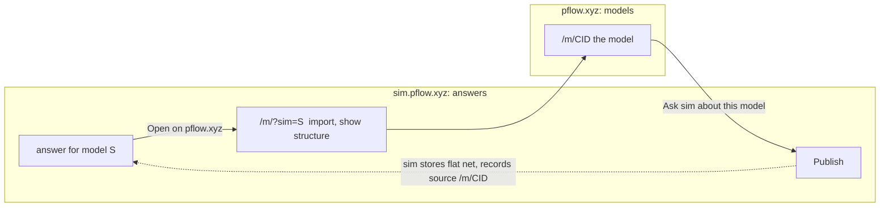

# Models first: re-centring pflow.xyz on models, not Petri nets alone

Status: **proposal for Matt's approval. Docs only; no code changes until he signs off.**
Date: 2026-10-28.
Parent: [ROADMAP.md](../../ROADMAP.md). This document supersedes the newcomer framing
of "Guided modelling and simulation in the browser" (ROADMAP.md:3-37) if approved;
the rest of the ROADMAP (phases 0-8) is built and stays.

Direction (Matt, 2026-10-28): "We love the prototype, so we should make views just as
good. It means re-centring pflow.xyz on 'models' now, not just Petri nets. We will
assume the pflow.xyz audience wants to get technical with the models, and the sim
audience just wants a utility to answer questions."

Everything below cites code as `path:line` at `origin/main` 57f6caf unless it names
another repo. pflow-native is cited at 1a13459, the commit the vendored wasm was built
from (`pflow-native-wasm.lock`). I could not read sim-pflow-xyz's source (private); sim
claims come from its README and the public site, as of 2026-10-28.

## Summary

1. A **model** is a composition (Bundle JSON: subnets + typed links) with its derived flat
   net, its search plan(s), its checks and receipts, and a CID. A single Petri net is the
   one-subnet, no-links case.
2. pflow.xyz is for people who open a model up: compose it, read it in ten conventions,
   check its laws, keep its receipts. sim.pflow.xyz is the utility that answers a question
   about one. Each links to the other's view of the same model.
3. The ten views from `/compose.html` become the **model page**; the Petri-net editor is
   the flat-net view of it. The landing page becomes a model library.
4. **Today's code cannot open a model.** `/compose.html` shows two hard-wired examples, and
   the registry cannot load or export a Bundle (section 1.3). The first real work is two
   registry commands in pflow-native, not UI.
5. Eight slices, the first of them copy and navigation only. Section 5.3 lists the nine
   decisions that are Matt's.

## 1. What a model is

### 1.1 The parts, in data the code already has

| Part | What it is | Where it is today | Identity |
|---|---|---|---|
| **Composition** | Subnets (`id`, `net_type`, a net) and typed links (`token`, `data`, `event`, `guard`) between ports, as a `PetriNetBundle` | `examples/showcase/cafe.bundle.json` (three subnets, six event links, one guard link). In the compose page it is built from a **catalog** of six pattern instances, not from JSON (`public/compose/model.js:36-38`, pflow-native `bundle.rs:31`) | CID over the Bundle JSON |
| **Flat net** | What `Flatten` makes of the composition: fused transitions, merged places, wires. Derived, never stored | `bundle.flatten` (`public/compose/model.js:122`) | none of its own: it is a function of the composition. Its own CID, if wanted, is the CID of the exported editor-shape net |
| **Search plan(s)** | A `SearchPlan` (order, drivers, memo, filters) for a game net, checked by pflow-rs | `plan.open`, `plan.check`, `plan.slot_candidates`; **only on the Connect-4 net** (pflow-native `plan.rs:24`, `:61`) | none yet; `plan.state` returns canonical JSON, so a CID is computable |
| **Laws** | Rewrites over the composition and the plan, checked by Chyp | four theories in `public/compose/chyp/*.chyp`, run live under Pyodide (`public/compose/laws-live.js`). They are about the *patterns*, not about one model | the theory files' sha256 (`compose/chyp/files.json`) |
| **Receipts and checks** | A run of a check with its engine version: link verdicts, scenario runs, lens test, vacuity, `analysis.verify` on the flat net | live, per page load (`bundle.validate`, `bundle.verdicts`, `bundle.run`, `bundle.lens`, then `artifact.clear` in `registry.js:33`); scenarios are frozen for orders only (`bundle.scenarios`) | none: the page keeps the answer, not the engine (`registry.js:20-22`) |
| **Provenance** | Parents, author, licence | `parents` on nets (`examples/showcase/README.md`, theme row); native's store keeps parents and licence beside a model | part of the sealed document when present |

A **single Petri net** is the degenerate model: a Bundle of one subnet and no links. Its
flat net is the net itself and the existing editor JSON-LD (Shape A) is its natural
serialisation. I have not run a one-subnet bundle through `bundle.flatten`, because
nothing can open one yet (1.3); slice 3 pins it with a fixture before relying on it.

**Identity.** The model's CID is the CID of its Bundle JSON, sealed by the existing sealer.
I checked on 2026-10-28 that `public/seal-cid.mjs` (`computeCid`) and Go's `cmd/cidprobe`
agree on `cafe.bundle.json`: `z4EBG9j1SUhuY7XnEcPfHQPzQkmqjUtgrD2wHADw8qdRbpnNt6W`. This
matches ROADMAP Phase 0's finding that the sealing `@vocab` hashes any key. There is no
parity fixture for a bundle yet (`parity/fixtures/` holds six nets), so that agreement is
unguarded. Plans and receipts stay **outside** the composition's identity: a plan is many
per model, and a receipt records a run, so neither may change the composition's CID.

### 1.2 What the ten views draw

All ten read the same four things from `ctx` (`public/compose/ctx.js:21-45`): `ctx.orders`
(the subnets, links and flat net), `ctx.plan`, `ctx.connect4` and `ctx.example`. That is
the model, spelled for two examples. Section 3.4 turns it into `ctx.model`.

### 1.3 What is missing in code

| # | Gap | Evidence | Fix |
|---|---|---|---|
| G1 | **No way to open a Bundle.** `bundle.open` takes catalog ids and links only | pflow-native `bundle.rs:70-82` (`instances` "from the catalog", `links`); `model.js:36-38` | pflow-native: `bundle.load {bundle}` |
| G2 | **No way to export the open composition** as Bundle JSON; the `bundle.*` set has no export | the id list from `crates/core/src/commands/bundle.rs`: `add_*`, `candidates`, `clear_links`, `close`, `flatten`, `incidence`, `instances`, `lens`, `ontology`, `open`, `remove_*`, `reset_links`, `run`, `scenarios`, `state`, `validate`, `verdicts` | pflow-native: `bundle.export` |
| G3 | **Plans exist only for Connect-4** | `plan.net` returns "the Connect-4 net the plan is for"; `plan.open` "on the Connect-4 net" | pflow-native: `plan.open {net}`; defer (slice 8) |
| G4 | **The composition is not in `session.dump_state`**, so a reload re-opens it by command and a user's composition would be lost | `public/petri-wasm.js:49` (`SAVED_PARTS` omits it), `:103`; `public/compose/state.js:1-8` | save the Bundle JSON app-side (IndexedDB) or add a `bundle` part to the dump |
| G5 | **The editor refuses a bundle**: `@type` must be `PetriNet` | `public/petri-validate.js:81-82` | fine: bundles open on the model page, not the editor. The server would store one: `validateJSONLD` checks only `@context`, depth and keys (`cmd/webserver/main.go:93-117`), untested with a bundle |
| G6 | **No model library format beyond bundles**: no index of models with title, CID, kind, thumbnail | landing cards hard-code six nets by CID (`public/index.html:525-570`) | `public/models/index.json`, data not code (slice 2) |
| G7 | **No model-level checks store**: receipts are not kept | `registry.js:20-22` | sidecar keyed by (CID, engine version); needs ontology Phase 4.3 for the faithfulness checks (slice 6) |
| G8 | **Parity fixtures and CID guard for bundles** | `parity/fixtures/` | add `bundle-cafe.jsonld` with the golden above |
| G9 | **Scenarios, and the lens fallback, exist for orders only** | `bundle.scenarios`: "commit, refund, charge-fails, second-order"; `public/compose/views/lens-orders.js` | a model declares its scenarios (data); other models get the strict lens test and a plain "no scenario declared" |

G1 and G2 are in another repo (pflow-native). Nothing in sections 3-5 can ship without
them except slices 1 and 2.

## 2. The audience split

### 2.1 Who is who

| | **pflow.xyz** | **sim.pflow.xyz** |
|---|---|---|
| Visitor | Wants to get technical with a model | Wants an answer |
| Arrives with | A model, a composition to build, a law to check | A decision or a question ("is a second car worth it?") |
| Leads with | The model's structure and every convention that reads it | The outcome, with its spread; the net stays the engine (sim README: "turn the knobs, inject disruptions, compare seeded scenarios") |
| Signature | Snap-together linking, source-cited hover, honesty labels, lens test, laws | Seeded what-if, "Measure influence", model catalog, MCP, Sheets |
| Identity | CID, immutable, content-addressed | content hash id (`/whatif/?id=7d73...`) |
| Sign-in | GitHub | Google |

sim's own pitch confirms the split: "describe a decision to an AI assistant, which builds a
model. A seeded simulation then estimates what each change is worth" (sim.pflow.xyz,
fetched 2026-10-28).

### 2.2 The boundary

| Capability | Home | Note |
|---|---|---|
| Compose subnets, snap-together links, link verdicts with codes | **pflow.xyz** | the prototype's signature |
| Ten views, laws, lens test, incidence, flat net, token game | **pflow.xyz** | |
| Structural analysis (invariants, siphons, verify, reach) | **pflow.xyz** | built (Phase 2); it is the technical audience's tool |
| Net editor | **pflow.xyz**, as the flat-net view | section 3 |
| Registry-driven assistant with visible tool calls (Phase 4) | **pflow.xyz**, reframed from "newcomer helper" to "operator of the registry" | ships dark, soft-launched to one login (ROADMAP.md:463-466) |
| Seeded scenarios, compare, diagnose, optimize (Phase 3) | **both**: the engines are shared, the *question-shaped surface* is sim's | pflow.xyz keeps the workbench for people who want the numbers |
| Describe a decision, get a model; plain-language results; question-shaped controls | **sim** | already there |
| Model catalog of worked decisions; publish to Sheets; licences; systems | **sim** | ROADMAP.md:397-405 already leaves these to sim |

### 2.3 Handoff



- **sim answer to pflow.xyz.** A sim page links `https://pflow.xyz/m/?sim=<sim id>`. The page
  fetches the public model (`GET /api/models/{id}` is public, per the sim site), imports it
  with `model.import`, and shows it as a one-subnet model with its own CID.
  *Unverified:* that sim's metamodel shape converts losslessly into the editor shape. The
  editor already exports the other way ("Copy for sim", `public/petri-appview-ui.js:69`), and
  pflow-native keeps a sim-id to CID mapping of its own (FEATURES.md, store row).
- **pflow.xyz model to sim.** "Ask sim about this model" publishes the **flat net** (sim has
  no composition term; `sim_compose` composes components, a different thing) and records the
  model URL as its source. ROADMAP.md:377 already has "Open in sim" as a link-out; this
  extends it with a stable back-link. A source field on sim is a sim-side decision
  (decision D7).
- A model that **cannot** be handed to sim says why (a guard link has no flat equivalent in
  sim's shape; a game net needs a plan). It never degrades silently.

### 2.4 What in ROADMAP.md is re-homed, frozen or dropped

Nothing is deleted. All eight phases are built and deployed (ROADMAP.md:453-466); the
change is where each is promoted.

| ROADMAP item | Decision | Why |
|---|---|---|
| Goal and problem statement, "newcomer" (ROADMAP.md:3-14) | **Replace** with the models-first goal (the section this PR adds) | contradicts the split |
| Direction "Start from a question, not a canvas" (:16) | **Re-home to sim**; on pflow.xyz, freeze the Phase 1 draft flow as built | sim leads with the question; pflow.xyz leads with the model. The draft flow later re-aims at "propose a composition from patterns" (ontology Phase 3-4), which is a technical act |
| "Sensible defaults", "Say which knobs matter", "Plain-language results" (:18-27) | **Re-home to sim** | the utility's job |
| Phase 5 goal advisor (:284) | **Freeze**: keep in the workbench; stop promoting it | it is sim's "answer a question" in another coat |
| Phase 7 app view and question-shaped controls (:353) | **Freeze**; sim is the owner. Open decision 3 (shared `petri-roles.js`) stays open | duplicates sim; drift risk (:531, pending item 16) |
| "Check the model before running it" (:24) | **Keep, promote**: it becomes the model page's Checks panel | technical audience |
| "Share with sim" (:28, :377) | **Keep, extend** to a two-way handoff (2.3) | |
| Decided 2026-10-15 (:31) | **Reconcile**, below | |

**Reconciling the 2026-10-15 decision.** It said: client-side engines, an LLM to help, and,
"unlike sim, which leads with outcomes, the goal here is to show users the Petri net design
itself". Keep the second half and widen it from the *net* to the *model*. Retire the first
half's premise, that pflow.xyz should serve the newcomer "the kind of service sim provides"
(:10-14). The browser engines and the LLM proxy stay as the technical audience's tools.

### 2.5 Copy that contradicts the new positioning

Flagged, not edited in this PR. They change in slice 1.

| Where | Says | Problem |
|---|---|---|
| `README.md:3` | "Interactive web component for authoring, visualizing, and simulating Petri nets." | Petri-net-only |
| `README.md:9` | "**Editor:** pflow.xyz \| **Models you can run and check:** sim.pflow.xyz" | gives *models* to sim; pflow.xyz is the editor |
| `README.md:11-19` | "Models on sim.pflow.xyz" is the first thing after the title | leads with the other audience |
| `README.md:27` | "Visual editor + browser ODE simulator" | |
| `README.md:120` | sells sim's tools as the AI route | pflow.xyz has its own `/mcp` (CLAUDE.md:145) |
| `ROADMAP.md:3-14`, `:62` | "someone who arrives with a question rather than a net"; "a newcomer can act on" | the newcomer framing |
| `ROADMAP.md:349` | "Done when a newcomer can go from a description..." | |
| `CLAUDE.md:7` | "a web-based visual editor and simulator for Petri nets" | |
| `public/index.html:9, :14, :23`, `:502` | title and H1 "Visual Editor for Petri Nets" | |
| `public/index.html:503-506` | "Prefer to start from a description? sim.pflow.xyz..." and the "Describe it instead (sim)" button | a good handoff, but it is the hero's second action; wrong default |
| `public/index.html:512-519` | the "Or start from a description" section | sim's pitch on pflow.xyz's page |
| `public/index.html:522` | "Example models, open in the editor" | models open in the editor, not on a model page |
| `public/index.html:487-491` | Compose is one small link in the nav | the prototype's work is not the front door |
| `public/compose.html:6, :18` | title "Composition views"; `pflow.xyz` links "back to the pflow.xyz editor" | the editor is the front door |
| `public/llms.txt:3` | "Visual Petri net editor with an embeddable ... library" | the recipe file machines read |
| `package.json:4` | "Dependency-free ES modules for Petri nets: ..." | the library description can stay; npm is a different surface (open question D9) |

A constraint on all new copy: the ontology ROADMAP says public copy must describe the
pipeline as "working toward" verified composition until the three faithfulness checks run
on every composed net (ontology-pflow-xyz ROADMAP.md:14). So pflow.xyz copy may say "checked
by": it must not say "verified" for a composed model before slice 6.

## 3. Information architecture

### 3.1 URLs

| URL | What | Status |
|---|---|---|
| `/` | Model library (landing) | changes (slice 1, 2) |
| `/m/<cid>` | The model page: ten views, panels. Hash holds view and state: `#v=cospan` | new; the Go server serves the same HTML, as `/o/` is served from storage (`cmd/webserver/main.go:314`) |
| `/m/<name>` | Built-in models by name (`orders`, `connect4-plan`) until they have CIDs | new, slice 2 |
| `/m/?sim=<id>` | Import from sim | new, slice 7 |
| `/compose.html#ex=orders&view=cospan` | The prototype's port | **redirects** to `/m/orders#v=cospan`; `readHash` is the whole contract (`public/compose/state.js:195-198`) |
| `/?cid=<cid>` and `/?data=` | The editor, as now | **stay, forever**: the blog, book, sim and the landing cards link to them (`index.html:525-570`) |
| `/o/<cid>` | The sealed JSON | as now; also serves bundles (G5) |
| `/img/<cid>.svg` | Thumbnail | nets only; a bundle's thumbnail is its flat net, drawn by the Go renderer (slice 4) |

### 3.2 Navigation

`Models` (library) · `New model` (empty composition, or paste a Bundle) · `Editor` (a blank
net, opens the flat-net view in edit mode) · `Docs` (book, llms.txt, `/mcp`) · right-aligned
`Just want an answer? sim.pflow.xyz →`. The sim link is permanent and plain, not a banner.

### 3.3 Screens

Landing (`/`):

```
┌────────────────────────────────────────────────────────────────────────┐
│ pflow   Models   New model   Editor   Docs        Just want an answer?  │
├────────────────────────────────────────────────────────────────────────┤
│  Compose, inspect and check models.                                      │
│  One model, many conventions. Every link rule is a mechanism's, not a    │
│  reading; every hover cites its source.        [Open orders ⊗ workers]   │
├────────────────────────────────────────────────────────────────────────┤
│  Compositions                      Search plans         Nets              │
│  ┌──────────┐ ┌──────────┐         ┌──────────┐        ┌────┐ ┌────┐     │
│  │ cafe     │ │ orders ⊗ │         │ connect-4│        │tic │ │SIR │ ... │
│  │ 3 subnets│ │ workers ⊗│         │ exact    │        │tac │ │    │     │
│  │ z4EB…Npt6W│ │ payment  │         │ plan     │        └────┘ └────┘     │
│  └──────────┘ └──────────┘         └──────────┘                           │
└────────────────────────────────────────────────────────────────────────┘
```

Model page (`/m/<cid>`), reusing `compose.html`'s regions (`#tabs`, `#toolbar`, `#stage`,
`#convention`, inspector, rules, composition, receipts):

```
┌────────────────────────────────────────────────────────────────────────┐
│ pflow  Models › cafe   z4EB…Npt6W   [Fork] [Share] [Ask sim about this]  │
├────────────────────────────────────────────────────────────────────────┤
│ Structure: 1 Cospans 2 Spiders 3 Operad 4 String 5 Boundaries            │
│ Net:       6 Flat net (edit) 7 Incidence 8 Runs                          │
│ Meaning:   9 Lens 0 Laws                                                 │
├──────────────────────────────────────────────┬─────────────────────────┤
│ toolbar: link kind chips · + instance · Reset │ Convention + honesty    │
│ ┌──────────────────────────────────────────┐ │ Inspector (hover cites) │
│ │                                          │ │ Rules (lit on a drop)   │
│ │              the drawing                 │ │ Links (3)               │
│ │                                          │ │ Checks  ← new           │
│ └──────────────────────────────────────────┘ │ Plans   ← new           │
│  snap status                                 │ Identity ← new          │
└──────────────────────────────────────────────┴─────────────────────────┘
```

The three groups are a proposal: they only regroup the ten tabs (`VIEW_IDS`,
`public/compose/ctx.js:53`). Keys 1-9 and 0 stay.

### 3.4 What changes in the code's shape

- `ctx.example` and the `if (state.example === 'orders')` branches (`public/compose/app.js:54,
  126, 137`; `views/boundaries.js:849`) become a **model kind** on `ctx.model`:
  `composition` (links, flat net), `plan` (slots, pieces) or `net` (a closed net).
  The "does not apply" notes (`boundaries.js:741-742`, `spiders.js:937`) become a per-kind
  rule: a view declares which kinds it applies to and emits its `na` element otherwise.
- `state.js` gains a model registry keyed by CID or name; `start()` opens the model by
  command (G1) instead of `bundle.open {}`.
- Engines stay three (live, scratch, c4; `registry.js:3-20`). `c4` becomes "the flat net as
  a document", for any model, not only Connect-4.

### 3.5 The editor

The editor stays as it is, `petri-view.js`, because the book, the blog and sim vendor or
link to it (ROADMAP.md Risks: it is pinned by sim's `/build/` page). It becomes reachable
two ways: as the **flat-net view's edit mode** for a one-subnet model, and at `/?cid=` as
now. For a composition, the flat net is **derived**, so it is read-only there, and editing
means changing subnets and links (snap-together). A change is a **Fork**: objects are
immutable once stored (CLAUDE.md, "Working with CIDs"), so an edit yields a new CID and the
parent goes in `parents`.

## 4. Views as good as the prototype

### 4.1 Where the compose page stands

The port is close in code: the ten view modules are 12,738 lines against the prototype's
12,549, and `compose/` carries the same snap engine, inspector, hover cites and honesty
notes. It differs in four ways.

| | Prototype (`pflow-views-prototype`) | pflow.xyz `/compose.html` |
|---|---|---|
| **Who decides a rule** | JS ports of go-pflow `validateLink` and pflow-rs `SearchPlan::check` | The registry, in wasm (`registry.js:1-22`). Better provenance: nothing is re-implemented |
| **Tests of the rules** | 338 node tests against recorded receipts: 5,576 link verdicts, 289 plans, 73 solver claims (README) | `parity/composition-views/` compares what each view *draws* with pflow-native's egui renderer (`parity_test.ts:1-14`); the verdict corpus lives in pflow-native |
| **Chyp and layout tests** | `chyp_headless` (49 tests), `hypergraph.test.mjs`, `lensfind.test.mjs` | none in pflow.xyz: no test touches `compose/layout/hypergraph.js` or `compose/chyp/py`, and Chyp's result is trusted from the live run |
| **Citations** | 17 bibliography entries checked against arXiv/doi (`data/receipts/citations.json`) | `sources.js` carries them; nothing checks them |
| **Screenshots** | 27, regenerated by `make screenshots` | 6, hand-made (`docs/screenshots/compose/`) |
| **Models** | two, hard-wired | two, hard-wired (G1) |
| **Dev loop** | `make check` regenerates receipts from go-pflow and pflow-rs | `make native-goldens`, vendored with a lock |

Two things the compose page does **better**: link legality has one source (pflow-native's
registry, shared with the egui app), and the web and native renderers are tied by goldens.
I compared by code, tests and docs. I did not do a side-by-side visual review; slice 5
starts with one.

### 4.2 The bar every view must meet

A view ships on the model page when it meets all of these. The first six are already
true of most views and become tests; the last two are the new work.

| # | Bar | How it is enforced |
|---|---|---|
| B1 | **Only mechanism-decided rules.** No link, port, piece or slot is drawn that the registry refused | structure: `compose/model.js` is the only module that asks (CLAUDE.md:117); a lint test: no view imports `registry.js` |
| B2 | **Every drawn element is inspectable**, and the hover cites file:line@rev | the manifest: each emitted element has an `info` with at least one cite or a stated reason |
| B3 | **Honesty labels**: analogy, judgment and not-applicable are said on the page | `convention.honesty` is non-empty for views 2, 3, 7, 9; an `na` element for every kind a view does not cover |
| B4 | **A lens test that says where a reading fails** (the Lens view) | `bundle.lens` result drawn, with the failing link named, for any composition |
| B5 | **Snap-together**: only legal links light up, refusals show the code | `bundle.candidates` drives `ctx.snap`; the existing goldens cover the states |
| B6 | **Deterministic**: same model, same drawing (prototype's VIEWS.md rule 7) | manifest parity (below) |
| B7 | **Works for any model of its kind**, not for two examples | a test renders every view for every model in `public/models/index.json` and checks the manifest is well-formed (the existing `manifest well-formed` test, `parity_test.ts`, extended over the library) |
| B8 | **Say what you cannot show**: a view that does not fit a model kind says so and draws the nearest honest thing | B3, plus a per-kind table in each view's `convention.examples` |

Per view, what B7 and B8 need:

| View | Applies to | Generalisation needed |
|---|---|---|
| 1 Cospans | compositions | none beyond B7; a closed net draws `∅ → N ← ∅` already |
| 2 Spiders | compositions with event links | plan: junctions (exists, `spiders.js:937`) |
| 3 Operad | compositions and plans | holes come from the model's subnets, not the catalog |
| 4 String | all | transition level already draws any flat net |
| 5 Flat net | all | scenarios from the model, not `bundle.scenarios` (G9) |
| 6 Boundaries | compositions | plan: `na` (exists, `boundaries.js:741`) |
| 7 Lens | compositions | strict test for any; the *fallback* is orders-only judgment (`lens-orders.js`) and is shown only when a model declares a forward pass |
| 8 Incidence | all | none |
| 9 Runs | all | needs a declared scenario or free play |
| 10 Laws | the patterns' laws | currently per theory, not per model; show which laws cover *this* model's link set, as `sync-spiders` does for the orders example |

### 4.3 Parity with pflow-native

pflow-native is being brought to the same prototype quality in a parallel task (branch
`feat/composition-views-quality`). The contract that ties the two is the scene manifest
(pflow-native `docs/composition-views-scene.md`; `parity/composition-views/goldens.json`,
vendored with `goldens.lock`). Consequences for this plan:

- Any slice that changes **what a view draws** (an element, an attribute, a new example or
  state) changes the contract and needs a **paired PR** in pflow-native: new goldens, new
  lock. Slices 5 and 6 do; slices 1-4 do not.
- A failing comparison is a finding about one renderer. It is never fixed by regenerating
  goldens (`parity_test.ts:12-14`). I keep that rule.
- New states for new models are reached by registry commands only, from a fresh session
  (`parity/composition-views/render.js:15-24`). The model library therefore needs G1 before
  a library model can be a golden.

## 5. Slices, risks, decisions

### 5.1 Order

Each slice is shippable alone. A push to `main` on pflow-xyz **deploys** (webhook;
ROADMAP.md:533-535), so every slice merged is live; slices that change copy or routes are
reviewed as such.

| # | Slice | Ships | Test | Size |
|---|---|---|---|---|
| **1** | **Positioning and navigation.** Landing hero and nav lead with models and Compose; sim becomes the plain right-hand link; README, CLAUDE.md, llms.txt, titles per 2.5. No new route | pages and docs | `make test`; one added deno test that every nav and card link on `index.html` resolves to a file or a known route | small |
| **2** | **Model page shell.** `/m/<name>` serves the compose page with the model chosen by name; `compose.html` redirects; `public/models/index.json` lists the two built-ins; view tabs grouped | route, one data file | the existing manifests unchanged (no goldens change); a test that `/compose.html#ex=orders&view=cospan` maps to `/m/orders#v=cospan` | small |
| **3** | **pflow-native: `bundle.load` and `bundle.export`.** Round trip `cafe.bundle.json` (load, export, same CID); one-subnet bundle; refusals as `[CODE] message`. Re-vendor via `make sync-native-wasm` | registry commands, new wasm | native tests and `parity/native` goldens; new `parity/fixtures/bundle-cafe.jsonld` with the golden CID; `make test-parity` | medium, cross-repo |
| **4** | **Identity and storage.** Seal a bundle in the browser, `/m/<cid>` served from `/o/<cid>`, Fork, `parents`; keep the composition in IndexedDB (G4). Thumbnail from the flat net | route, storage use | CID parity JS/Go on the bundle fixture; a Go test that `/m/<cid>` returns the page; reload keeps the composition | medium |
| **5** | **Views for any model** (`ctx.model`, kinds, B7, B8). Starts with the side-by-side visual review against the prototype and a screenshots target (27, not 6). Adds `cafe` as a third model and state | views, goldens | deno manifest tests over the whole library; paired pflow-native goldens | large; pair with native |
| **6** | **Checks and receipts panel.** Per model: `analysis.validate/verify` on the flat net, scenarios the model declares, the lens test, laws that cover it; stored as a sidecar by (CID, engine version). Faithfulness checks (vacuity, scenario, semantic) when ontology Phase 4.3 lands | panel, store | each check has a fixture whose verdict is known (a saga that cannot reach `undo` fails vacuity) | medium; blocked in part on ontology Phase 4 |
| **7** | **sim handoff**, both directions (2.3) | import route, button | `model.import` round trip on a sim-shaped fixture; a link check; the sim side is its owner's change | small here, needs sim |
| **8** | **Editor reposition and plans beyond Connect-4.** Flat-net edit mode; `/` stops being the editor but `/?cid=` and `?data=` still are; `plan.open {net}` (native) | routes, command | the editor's existing deno suites; a legacy-URL test | medium |

Slice 1 is deliberately the one with no engine risk: it is the cheapest way to see whether
the positioning reads right before more is built on it.

### 5.2 Risks

| Risk | Mitigation |
|---|---|
| **The wasm is about 1.66 MB gzip** (FEATURES.md, wasm row) and the landing becomes a library | the landing loads no wasm; the model page loads it on open, as `petri-wasm.js` does today. Thumbnails are static SVG |
| **Cross-repo coupling**: slices 3, 5, 8 need pflow-native; slice 7 needs sim, which I cannot read | one PR pair per slice; the web side vendors by lock; name an owner per repo before starting |
| **Goldens drift** between two renderers while pflow-native is also being rebuilt | pair PRs, never regenerate to pass (4.3); freeze manifest-changing work in either repo until the parallel task lands |
| **The prototype repo** (`pflow-views-prototype`, local only, no remote) and the compose port diverge | keep it as the visual reference until slice 5, then archive; the port already notes it copied from `91695ad` |
| **Ontology IRIs** (`pat:`, `lk:`) are not served at ontology.pflow.xyz, so a hover link would 404 | the page already says so; do not add IRI links until Phase 1 serves them |
| **Overclaiming**: "verified model" before the faithfulness checks run on every composition | copy rule in 2.5 |
| **Naming collision**: ROADMAP Phase 7's `views` term is sim's screens (board, dashboard, controls...), not the ten conventions | user-facing: "views" means the ten; call sim's "screens" in prose; leave the schema term alone (decision D5) |
| **Audience loss**: a newcomer lands on pflow.xyz and finds a technical page | the permanent "Just want an answer?" link and sim's example cards one click away; the landing copy says who the page is for |
| **LLM features** (Phase 1, 4) are on for one login only (ROADMAP.md:463-466) | no change to them; this proposal only changes their framing |
| **Deploy on push** | per slice, reviewed as a release |

### 5.3 Decisions only Matt can make

| # | Decision | Recommendation |
|---|---|---|
| D1 | Is a `PetriNetBundle` the model's wire format, with the CID over it? | **Yes.** It is what `cafe.bundle.json` is and what Go and JS already seal identically |
| D2 | Plans: embedded in the model, or separate documents that reference a model CID? | **Separate**, referencing the CID. A plan is many-per-model and must not change the composition's identity |
| D3 | Do `/?cid=` and `/?data=` stay as the editor forever? | **Yes.** Too many external links; `/m/<cid>` is the new front door |
| D4 | Does `/` stop being the editor (slice 8)? | **Yes, but late**, after slices 2-5 prove the library. Before that, `/` is the landing and the editor opens from it as now |
| D5 | Vocabulary: "model" and "views" for users; sim's `views` become "screens" in prose only | **Yes.** No schema change |
| D6 | ROADMAP phases 1, 5, 7: freeze rather than remove or keep promoting | **Freeze.** They are built and deployed; deleting loses work, promoting them contradicts the split |
| D7 | Handoff: what sim receives (flat net, in which shape) and whether it stores a source link back | **Flat net with a source URL**, if sim's owner agrees; a sim-side change I cannot make or read |
| D8 | What happens to `pflow-views-prototype` | **Keep as the visual reference to slice 5, then archive** (it has no remote; your call where the archive lives) |
| D9 | Do the npm package and `llms.txt` re-centre too, or stay "Petri nets" for the library audience | **llms.txt yes** (machines read it first); **package description no**: the library really is Petri-net ES modules |

Nothing here was started in code. If you approve, slice 1 is the first PR.
