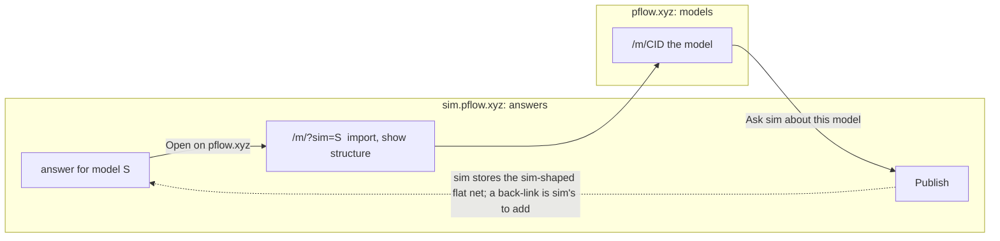

# Models first: re-centring pflow.xyz on models, not Petri nets alone

Status: **proposal for Matt's approval. Docs only; no code changes until he signs off.**
Date: 2026-10-28. Revised the same day after an adversarial review of the first draft
(293 claims checked: 197 confirmed, 92 partly wrong, 4 refuted) and a completeness critique.
The PR comment lists what changed and what was declined.
Parent: [ROADMAP.md](../../ROADMAP.md). This document supersedes the newcomer framing
of "Guided modelling and simulation in the browser" (ROADMAP.md:3-37, numbered as at 57f6caf;
see below) if approved; the rest of the ROADMAP (phases 0-8) is built and stays.

Direction (Matt, 2026-10-28): "We love the prototype, so we should make views just as
good. It means re-centring pflow.xyz on 'models' now, not just Petri nets. We will
assume the pflow.xyz audience wants to get technical with the models, and the sim
audience just wants a utility to answer questions."

**How cites work.** `path:line` is pflow-xyz at `origin/main` 57f6caf, the base of this PR.
The PR changes only this file and ROADMAP.md, so every code cite holds at the PR head too.
ROADMAP.md is the exception: the PR inserts 25 lines at its top (the proposal section, lines
3-27), so in this branch every line of the old text is 25 higher than the number cited here.
Other repos carry a prefix and are cited at the revision named: `native:` pflow-native 1a13459 (the commit the vendored
wasm was built from, `pflow-native-wasm.lock`), `rs:` pflow-rs aacb7eb (what native pins),
`go:` go-pflow 08df007, `sim:` sim-pflow-xyz 8c76e54, `onto:` ontology-pflow-xyz a47801d,
`proto:` pflow-views-prototype 91695ad (local only). `compose/` abbreviates `public/compose/`.
sim-pflow-xyz is private but readable with the maintainer's account
(`gh api repos/pflow-xyz/sim-pflow-xyz/contents/<path>`); the sim claims below were checked
against that source, and against sim.pflow.xyz as fetched on 2026-10-28.

## Summary

1. A **model** is a composition (subnets and typed links) with its derived flat net, its
   search plan(s), its checks and receipts, the curated content that explains it (findings,
   notes, scenarios) and a CID. A single Petri net stays a **net**: whether it is wrapped as a
   one-subnet bundle or keeps its editor shape and its CID is D10 (recommended: it keeps both).
2. pflow.xyz is for people who open a model up: compose it, read it in ten conventions,
   check its laws, keep its receipts. sim.pflow.xyz is the utility that answers a question
   about one. Each links to the other's view of the same model.
3. The ten views from `/compose.html` become the **model page**; the Petri-net editor is
   the flat-net view of it. The landing page becomes a model library.
4. **Today's code cannot open a model, and a bare Bundle cannot carry what the views draw.**
   `/compose.html` shows two hard-wired examples, the registry cannot load or export a Bundle
   (1.3), and a Bundle has no pattern instances or port schemas, which snap-together, port
   colours and most hovers are built on (1.4). The first real work is a format decision (D1)
   and two registry commands in pflow-native, not UI.
5. Eight slices, the first of them copy and navigation only. Section 5.3 lists the fourteen
   decisions that are Matt's; D10-D14 are new in this revision.

## 1. What a model is

### 1.1 The parts, in data the code already has

| Part | What it is | Where it is today | Identity |
|---|---|---|---|
| **Composition** | Subnets (`id`, `net_type`, a net) and typed links (`token`, `data`, `event`, `guard`) between ports, as a `PetriNetBundle` | `examples/showcase/cafe.bundle.json` (three subnets, six event links, one guard link). The compose page does not read JSON: it builds the composition from a **catalog** of six pattern instances (`compose/model.js:67-71`, `:152`; `native:crates/core/src/commands/bundle.rs:31`), and native's `Composition` keeps each instance's pattern, parameters and rationale beside the Bundle (`native:crates/core/src/composition/mod.rs:56-66`, `:401`) | CID over the Bundle JSON (D1) |
| **Flat net** | What `Flatten` makes of the composition: fused transitions, merged places, wires. Derived from the composition, never part of the model or its CID | `bundle.flatten` (`compose/model.js:122`); the engine saves a "Flat composition" report artifact in the session (`native:crates/core/src/commands/bundle.rs:602-610`) and the page clears it after the call (`compose/registry.js:28`, `:65`) | none of its own: a flat-net CID needs an export that does not exist. The report is not editor JSON-LD, and the nearest code, go-pflow's `metapetri.ConvertBundle` (`go:metamodel/metapetri/convert.go:407`), drops expression guards (`GUARD_DROPPED`, `:76`) |
| **Search plan(s)** | A `SearchPlan` (order, drivers, memo, filters) for a game net, checked by pflow-rs | `plan.open`, `plan.check`, `plan.slot_candidates`; **only on the Connect-4 net** (`native:crates/core/src/commands/plan.rs:24`, `:61`) | none yet. `plan.state` returns the plan's JSON with keys in plan.rs order (`native:crates/core/src/search_plan.rs:359`): stable, but not the sorted-key canon the model CID uses, and absent and default-valued fields give different text. A plan CID needs a canonical form chosen first (D2) |
| **Laws** | Rewrites over the composition and the plan, checked by Chyp | four theories in `compose/chyp/*.chyp`, run live under Pyodide (`compose/laws-live.js`). They are about the *patterns*, not about one model | the theory files' sha256 (`compose/assets/chyp/index.json`, recomputed by `compose/views/laws.js`; `compose/chyp/files.json` lists the theories by name and hashes the Python files loaded into Pyodide) |
| **Receipts and checks** | A run of a check with its engine version: link verdicts, scenario runs, lens test, vacuity, `analysis.verify` on the flat net | live, on demand: link verdicts from `bundle.candidates` and `bundle.add_link` (`compose/state.js:111`, `:136-144`); scenario runs and the lens test from `bundle.run` and `bundle.lens` (`compose/model.js:206`, `:302`; `compose/views/flat.js:1004`; `compose/views/process.js:787`). Each artifact-storing call is followed by `artifact.clear` (`compose/registry.js:28`, `:65`). Scenarios are frozen for orders only (`bundle.scenarios`) | none: the page keeps the answer, not the engine (`compose/registry.js:22-24`) |
| **Curated content** | The findings, notes and frozen scenario predicates that make a view worth reading, written per example | in the view code, keyed by example (1.5) | none yet (D11) |
| **Provenance** | Parents, author, licence | `parents` exists today on single nets only (`internal/seal/seal.go:61-68`, `public/petri-validate.js:90-91`); native's store keeps parents and licence beside a model (`native:crates/core/src/store/mod.rs:5-9`) | `parents` is part of the sealed document when present; the Bundle types define no such field (3.5) |

A **single Petri net** is the closed case. It already has a shape (editor JSON-LD, "Shape A":
places and transitions as maps with `x`/`y`) and a CID. A Bundle subnet has another (places as
an array, and no field for a position: `go:metamodel/schema.go:182-192`), so wrapping a net as a one-subnet bundle gives it a second CID and drops
its layout (D10). A one-subnet, no-link composition can already be opened from the catalog
(`bundle.open` with one instance and `links: []`, `native:crates/core/src/commands/bundle.rs:353-368`),
and pflow-rs tests one-subnet `Bundle::flatten` as an identity
(`rs:crates/pflow-compose/tests/flatten.rs:93-103`). I have not run that path in the browser.
What cannot be opened is an arbitrary single net supplied as Bundle JSON (G1); slice 3 pins it
with a fixture before relying on it.

**Identity.** The model's CID is the CID of its Bundle JSON, sealed by the existing sealer.
I checked on 2026-10-28 that `public/seal-cid.mjs` (`computeCid`) and Go's `cmd/cidprobe`
agree on `cafe.bundle.json`: `z4EBG9j1SUhuY7XnEcPfHQPzQkmqjUtgrD2wHADw8qdRbpnNt6W`. This
matches ROADMAP Phase 0's finding that the sealing `@vocab` hashes any key. Running the sealer
on variants: reversing the order of subnets and links leaves the CID unchanged (they hash as
unordered sets), and adding any key changes it (a `pattern` key on one subnet, or `parents`).
Both Bundle structs drop unknown keys on load (`rs:crates/pflow-compose/src/bundle.rs:238-262`,
no `deny_unknown_fields`; `go:metamodel/compose.go:208`), so an annotation that is not a field
of both does not survive load then export, and the exported CID differs from the sealed one.
There is no parity fixture for a bundle yet (`parity/fixtures/` holds six nets), so the
JS and Go agreement is unguarded. Plans and receipts stay **outside** the composition's
identity: a plan is many per model, and a receipt records a run, so neither may change the
composition's CID. A CID names fixed content, so an edit gives a new CID; the stored object is
not immutable, though: its author can delete it (`DELETE /o/{cid}`, `cmd/webserver/main.go:548-549`).

### 1.2 What the ten views draw

The ten views get the model from `ctx` (`compose/ctx.js:24-51`) under four keys: `ctx.orders`
(the subnets, links and flat net), `ctx.plan`, `ctx.connect4` and `ctx.example`, plus
`ctx.event` (the last change). Not every view reads all four: Incidence and Processes never
read `ctx.plan` (they draw the Connect-4 net in its place), and Laws, Lenses and Operad never
read `ctx.connect4`. The views also go around `ctx`: Flat net and Processes import `engines`
from `compose/registry.js` and call `bundle.run` themselves (`compose/views/flat.js:1004`,
`compose/views/process.js:787`), and they import `compose/model.js` functions directly
(`flatten`, `chainOf`, `driversOf`, `fire`, `lens`). Together these fields are the model,
spelled for two examples. Section 3.4 turns them into `ctx.model`, which also means routing
those direct calls through it.

### 1.3 What is missing in code

| # | Gap | Evidence | Fix |
|---|---|---|---|
| G1 | **No way to open a Bundle.** `bundle.open` takes catalog ids and links only | `native:crates/core/src/commands/bundle.rs:70-82` (`instances` "from the catalog", `links`); `compose/model.js:67-71`, `:152` | pflow-native: `bundle.load {bundle}` |
| G2 | **No way to export the open composition** as Bundle JSON; the `bundle.*` set has no export | the id list from `native:crates/core/src/commands/bundle.rs`: `add_*`, `candidates`, `clear_links`, `close`, `flatten`, `incidence`, `instances`, `lens`, `ontology`, `open`, `remove_*`, `reset_links`, `run`, `scenarios`, `state`, `validate`, `verdicts` | pflow-native: `bundle.export` |
| G3 | **Plans exist only for Connect-4** | `plan.net` returns "the Connect-4 net the plan is for"; `plan.open` "on the Connect-4 net" (`native:crates/core/src/commands/plan.rs:61-68`) | add a `net` argument to the existing `plan.open`, with matching support in `plan.net`, `plan.opening` and `plan.slot_candidates`; defer (slice 8) |
| G4 | **The composition is not in `session.dump_state`**, so a reload re-opens it by command and a user's composition would be lost | `public/petri-wasm.js:49` (`SAVED_PARTS` omits it), `:103`; `compose/state.js:9-10`; `native:crates/core/src/commands/session.rs:31-39` (`PARTS` has no bundle part) | persist the Bundle app-side or add a `bundle` part; where it lives is D12 |
| G5 | **The editor refuses a bundle**: `@type` must be `PetriNet` | `public/petri-validate.js:81-82` | fine: bundles open on the model page, not the editor. The server would store one: `validateJSONLD` checks only `@context`, depth and keys (`cmd/webserver/main.go:93-120`) |
| G6 | **No model library format beyond bundles**: no index of models with title, CID, kind, thumbnail | landing cards hard-code six nets by CID (`public/index.html:525-570`) | `public/models/index.json`, data not code (slice 2) |
| G7 | **No model-level checks store**: receipts are not kept | `compose/registry.js:22-24` | a sidecar keyed by (CID, engine version), or native's store and receipts (D12); needs ontology Phase 4.3 for the faithfulness checks (slice 6) |
| G8 | **Parity fixtures and CID guard for bundles** | `parity/fixtures/` | add `bundle-cafe.jsonld` with the golden above, plus a reordered-subnets variant |
| G9 | **Scenarios, and the lens fallback, exist for orders only** | `bundle.scenarios`: "commit, refund, charge-fails, second-order"; `compose/views/lens-orders.js` | a model declares its scenarios (data); other models get the strict lens test and a plain "no scenario declared" |
| G10 | **A Bundle lacks the pattern and port data the views draw** | 1.4 | decision D1 |
| G11 | **The per-example content is in the view code** | 1.5 | decision D11 |
| G12 | **Every surface keyed by CID assumes a net** | A stored bundle opens a broken editor at `/?cid=` (the editor loads any `/o/<cid>` blindly, `public/petri-view.js:2189-2197`); `handleGetSVG` hands the stored object to the net renderer at `/img/<cid>.svg` (`cmd/webserver/main.go:344-385`); the share card gets an empty card (`cardPayload` expects `places` and `transitions` maps, `cmd/webserver/share_card.go:50-58`, `:89-91`); the sitemap lists `/img/<cid>.svg` for every stored CID (`cmd/webserver/sitemap.go:35-40`) | a branch on `@type` in each, before the first bundle is saved (slice 4) |

G1 and G2 are in another repo (pflow-native), and pflow.xyz picks them up only by re-vendoring
the wasm (`make sync-native-wasm`, `pflow-native-wasm.lock`). Slices 3-5, and the library parts
of section 3 (opening a model by command in `start()`, `/m/<cid>`, Fork and seal), cannot ship
without them. Slices 1 and 2 can. So can the section-4 parity work on the two built-in models
(layout and Chyp tests, the citation check, the screenshots target, the B1-B6 tests). The
route half of slice 8 can ship too; its native half depends on G3, not on G1 or G2. Slices 6
and 7 depend on G1/G2 only in part: the receipts store needs a sealed CID (G2), and showing an
imported net as a composition needs G1.

### 1.4 The model format (D1)

**What a Bundle carries, and what the views need.** `cafe.bundle.json` has subnets (a net
each), links between transitions, constraints, `namespace` and `arc_merge`. It has no pattern
name, no parameters, no port schema and no layout. The compose page's model is richer: native's
`Composition` holds `InstanceSpec {pattern, label, params, why}` for every instance
(`native:crates/core/src/composition/mod.rs:56-66`), `bundle.add_link` takes `{subnet, port}`
ends whose legality and colour come from the pattern's port schema
(`native:crates/core/src/commands/bundle.rs:134-147`), and the ontology keys come from a frozen
catalog (`bundle.instances`, `compose/model.js:67-71`). Twelve modules under `compose/` name
patterns, ports or idioms: Operad holes, port colours, snap-together, idiom and cq/13 lighting,
hover cites. A Bundle loaded from JSON keeps Flatten, validation (cafe's links join
transitions, so they need no ports), incidence and the token game on the flat net. Scenario
runs and the lens test need declared scenarios (G9, B4). It loses ports, snap-together
candidates, Operad holes and pattern hovers, unless the pattern data travels with it. The
ontology plan already proposes a record for that data: an `ns:Composition` of pattern
instances with parameter bindings, pattern links and `ns:verifiedBy`, from which
`scripts/emit-bundle.py` derives the Bundle (`onto:ROADMAP.md:268-272`). It is marked PROPOSED:
"nothing in any repo implements it yet" (`onto:ROADMAP.md:24`).

| Option | Identity | Views keep | Changes in | Cost and risk |
|---|---|---|---|---|
| **A. Bare Bundle** (the first draft's D1) | CID of the Bundle: pins the executable net | Flat net, String, Incidence, the token game; Processes and Lenses once scenarios are declared (G9); the rest take the B8 "cannot show" path for loaded models | pflow-native only | Cheapest. Library models lose the signature interaction. Adding pattern data later gives the same composition a second CID, or leaves it unhashed |
| **B. Composition record** (ontology Phase 4 `ns:Composition`: instances, parameters, links; Bundle derived) | CID of the record | everything for pattern-built models; a hand-written bundle like cafe cannot be expressed | ontology Phase 4 (unbuilt), emit script, native | The CID pins parameters, not the net: the same record through a later constructor revision gives a different net under one CID. Blocked on unbuilt work |
| **C. Bundle plus optional `pattern`, `params` (and `parents`) on each Subnet** | CID of the annotated Bundle: pins the net and how it was built | everything for annotated bundles; unannotated ones degrade as in A | one schema PR in pflow-rs and go-pflow together, plus native | Permanent once CIDs are minted. Annotated and unannotated forms of one net get different CIDs. `parents` for Fork needs this PR anyway (3.5) |
| **D. Bare Bundle plus a sidecar** keyed by the Bundle CID, not hashed | CID of the Bundle | everything, given the sidecar | native, pflow.xyz | The CID is stable when annotations change; the sidecar can be lost without the model noticing (the envelope pattern sim and native use: `sim:pkg/modelstore/lineage.go:14-27`, `native:crates/core/src/store/mod.rs:5-9`). Carries curated content too (1.5) |

Whatever is chosen, name the exact shape: `metamodel.Bundle` (`go:metamodel/compose.go:37`,
`:208`) and its twin `pflow_compose::Bundle` (`rs:crates/pflow-compose/src/bundle.rs:240`).
go-pflow has a second `PetriNetBundle` in `go:tokenmodel/subnet/subnet.go:36` whose links
use `from_subnet` (`:78`); `bundle.load` must refuse it with an error code instead of sealing
something that means another thing.

### 1.5 What makes the prototype good is content written per example

Much of the prototype's quality is not code but text written for one example: the findings its
cross-checks surfaced (the pool leaks a worker on rollback while conservation still holds; one
saga is one case; the three-way rendezvous: `proto:README.md:112-120`), hover notes keyed to
particular ids, frozen scenario predicates and each view's `convention.examples` table. The
port keeps all of it, hard-wired: `compose/views/flat.js:1017-1039` and `:1125-1133` narrate
`workers/release`, `payment/rolled_back` and `pool_conservation`; `compose/views/laws.js:378`
and `:1069` handle only orders with `sync-spiders`; `compose/views/string.js:203-205` and
`compose/views/flat.js:1403-1404` branch on the example. Twenty-eight sites in twelve files
test `ctx.example` or `state.example`. B7 and B8 (4.2) make the code generic and make a new
model say "n/a"; they do not give a new model anything to say. A library full of bare drawings
is not "as good as the prototype". So content is part of the model (D11): a per-model document
of findings with their evidence, notes keyed by element id, declared scenarios with their
predicates and convention examples, with a validator that every id it names exists. Part of it
can be generated once slice 6 runs the checks (conservation, vacuity); the rest is written.
The ontology's Phase 6 aim, "a diagram is a query result" (`onto:ROADMAP.md:494-515`,
`ns/diagrams.ttl`), is the other source and is not connected to the views yet.

## 2. The audience split

### 2.1 Who is who

| | **pflow.xyz** | **sim.pflow.xyz** |
|---|---|---|
| Visitor | Wants to get technical with a model | Wants an answer |
| Arrives with | A model, a composition to build, a law to check | A decision or a question ("is a second car worth it?") |
| Leads with | The model's structure and every convention that reads it | The outcome, with its spread; the net stays the engine (sim README: "turn the knobs, inject disruptions, compare seeded scenarios") |
| Signature | Snap-together linking, source-cited hover, honesty labels, lens test, laws | Seeded what-if, "Measure influence", model catalog, MCP, Sheets |
| Identity | CID from the canonical content (`seal.SealJSONLD`): an edit gives a new CID, and content under a CID never changes, though its author can delete the object | content hash id, the sha256 of the model's canonical JSON (`sim:pkg/modelstore/store.go:6`, `:597`; `/whatif/?id=7d73...`) |
| Sign-in | GitHub in the editor; GitHub or Google for MCP clients (`cmd/webserver/mcp_oauth.go:165-177`, `public/terms.html:30`) | Google |

sim's own pitch confirms the split: "Describe a decision to your AI assistant. It builds the
model, and a seeded simulation, not the assistant, works out what each change is worth, with
its spread." (sim.pflow.xyz, fetched 2026-10-28).

### 2.2 The boundary

| Capability | Home | Note |
|---|---|---|
| Compose subnets, snap-together links, link verdicts with codes | **pflow.xyz** | the prototype's signature |
| Ten views, laws, lens test, incidence, flat net, token game | **pflow.xyz** | |
| Structural analysis (invariants, siphons, verify, reach) | **pflow.xyz** | built (Phase 2); it is the technical audience's tool |
| Net editor | **pflow.xyz**, as the flat-net view | section 3 |
| Registry-driven assistant with visible tool calls (Phase 4) | **pflow.xyz**, reframed from "newcomer helper" to "operator of the registry" | ships dark, soft-launched to one login (ROADMAP.md:463-466) |
| Seeded scenarios, compare, diagnose, optimize (Phase 3) | **both**: the same engines at parity, not shared code. sim runs go-pflow v0.34.0 (`sim:go.mod:10`); pflow.xyz runs the pflow-native wasm and JS engines held byte-exact to go-pflow on the same fixtures (ROADMAP.md:90-91, principle 3 "One answer everywhere"). The *question-shaped surface* is sim's | pflow.xyz keeps the workbench for people who want the numbers |
| Describe a decision, get a model; plain-language results; question-shaped controls | **sim** | already there |
| Collections (read here as a catalog of worked decisions), licences, migrations, map store; publish to Sheets | **sim** | ROADMAP.md:397-405 already leaves these to sim |
| Systems: stored models joined by port bindings | **both, different things** | pflow-native brings `systems` to pflow.xyz (ROADMAP.md:52, :141); sim has its own (2.3) |

### 2.3 Handoff



- **sim answer to pflow.xyz.** A sim page links `https://pflow.xyz/m/?sim=<sim id>`. The page
  fetches the model (`GET /api/models/{id}` is public and CORS-open, `sim:cmd/sim-server/models.go:57`;
  a fetch on 2026-10-28 returned 200) and imports it with `model.import` (in the vendored
  registry, `public/vendor/pflow-native-wasm/commands.js:1156`: it takes a pflow JSON document
  and adds a **net** to the library without opening it). What the visitor sees is a net with its
  own CID (D10), not a composition. The conversion is lossless only for token-only nets: sim's
  schema also carries transition guards, data places, event and HTTP bindings, arc keys,
  constraints, roles, access, navigation and simulation settings
  (`sim:schema/petri-model.schema.json`), none of which the editor shape holds, and pflow.xyz's
  own portable contract rejects guards and non-token places (`public/petri-ssa.js:247-248`,
  `:275-289`). So the import converts a token-only model and otherwise refuses or lists exactly
  what it drops. pflow-native keys its store by pflow.xyz CID and keeps no sim-id to CID map
  (`native:crates/core/src/store/mod.rs:5-9`; `native:FEATURES.md:111`), so `?sim=<id>` needs a
  new lookup or a re-seal.
- **pflow.xyz model to sim.** "Ask sim about this model" sends sim's own shape, built from the
  flat net by `file.export_sim` / `toSim` (`public/petri-commands.js:1084-1104`,
  `public/petri-roles.js:27`): a model plus the rates document role derivation reads. It is
  not the Bundle, not editor JSON-LD, and not a sim System. `toSim` is itself lossy (it drops
  capacities, arc weights and positions), and `bundle.flatten` returns places, transitions,
  arcs and constraints with no rates (`compose/model.js:122-141`), so a rate-less saga would
  reach sim with nothing to turn: "Ask sim" refuses, and says why, when role derivation finds
  no knobs. The source URL cannot go in the model body: sim's id is a hash of the body and its
  schema has no source field, so a back-link would change the id. sim keeps provenance in an
  envelope beside the content (`sim:pkg/modelstore/lineage.go:14-27`), and its JSON-LD context
  already maps `wasDerivedFrom` to `prov:wasDerivedFrom` with `@type: @id`
  (`sim:pkg/runtime/sim/jsonld.go:149`), so an absolute `https://pflow.xyz/m/<cid>` (the CID,
  not a name) is a valid value. Whether sim records it is its owner's change (D7);
  pflow.xyz keeps its own CID to sim-id record, so slice 7 does not wait for sim.
  ROADMAP.md:377 plans "Open in sim" as a link-out, but the shipped editor has only
  "Copy for sim" (`public/petri-appview-ui.js:69`), which copies sim-shaped JSON for
  `sim_create_model`; this builds the link-out and adds the back-link.
- **sim has compositions of its own.** The first draft said sim has no composition term. It
  does: Systems of stored models joined by port bindings checked by `binds-port-v1`/`v2` and
  run as pipelines (`sim:README.md:104-105`, `:116`), with `isomorphicTo` and `subnetOf`
  proofs (`sim:README.md:99`), and four bundles of its own embedded in the server
  (`sim:services/bundles/`: cafe, shop, fulfillment, warehouse; `sim:services/embed.go:10`).
  These are loose runtime couplings between separate nets, not one fused composition; a guard
  link has no binding equivalent, so mapping a pflow.xyz composition onto a System would claim
  more than it carries. `sim_compose` is a third thing: it fuses registry components into one
  flat net. And two unrelated "cafe" compositions already exist: sim's
  (`sim:services/bundles/cafe.bundle.json`: nine links, no `@context` or `@type`) and
  `examples/showcase/cafe.bundle.json` (seven links, sealed). The library says which it shows.
- A model that **cannot** be handed to sim, or loses something on the way, says why. It never
  degrades silently. A guard link flattens to read or inhibitor arcs, or to a `tokens(...)`
  guard conjunct (`go:metamodel/compose.go:16`, `go:metamodel/compose_flatten.go:425`), and
  sim runs both; an expression-lowered guard (`W_GUARD_OPAQUE`, `go:metamodel/compose.go:453`)
  weakens some of sim's static answers, so the handoff names which. A game net needs a plan,
  which sim's model shape does not carry.

### 2.4 What in ROADMAP.md is re-homed, frozen or dropped

Nothing is deleted. All nine phases (0-8) are built and deployed (ROADMAP.md:455-456; every
phase heading carries a checkmark, :174-385). Phase 8's attach-to-tab is deferred, and phases 1
and 4 are on for one login (:463-466). The change is where each is promoted. ROADMAP line
numbers in 2.4 and 2.5 are as at 57f6caf.

| ROADMAP item | Decision | Why |
|---|---|---|
| Goal and problem statement, "newcomer" (ROADMAP.md:3-14) | **Supersede** with the models-first goal (the section this PR adds); rewriting or removing the old text follows approval | contradicts the split |
| Direction "Start from a question, not a canvas" (:16) | **Re-home to sim**; on pflow.xyz, freeze the Phase 1 draft flow as built | sim leads with the question; pflow.xyz leads with the model. The draft flow later re-aims at "propose a composition from patterns" (ontology Phase 3-4), which is a technical act |
| "Sensible defaults", "Say which knobs matter", "Plain-language results" (:18-19, :22-23, :26-27) | **Re-home to sim** | the utility's job |
| Phase 5 goal advisor (:284) | **Freeze** the question-shaped surface: keep the dialog as built ("What do you want to know?", `public/petri-goals-ui.js`, opened from the editor menu at `public/petri-view.js:7860`, not linked from `index.html`) and stop promoting it. Keep `goals.json`: it is also the Assistant's analyse-mode brief (CLAUDE.md:118, `cmd/webserver/llm_goals.go`) | it is sim's "answer a question" in another coat (D6 says what "freeze" covers) |
| Phase 7 app view and question-shaped controls (:353) | **Freeze**; sim is the owner. Open decision 3 (shared `petri-roles.js`) stays open | duplicates sim; drift risk (:531, pending item 16) |
| "Check the model before running it" (:24) | **Keep, promote**: it becomes the model page's Checks panel | technical audience |
| "Share with sim" (:28, :377) | **Keep, extend** to a two-way handoff (2.3) | |
| Decided 2026-10-15 (:31) | **Reconcile**, below | |

**Reconciling the 2026-10-15 decision.** It said: client-side engines, an LLM to help, and
"unlike sim, which leads with outcomes […], the goal here is to show users the Petri net
design itself" (ROADMAP.md:31). Keep the second half and widen it from the *net* to the
*model*. Retire the first half's premise, that pflow.xyz should serve the newcomer "the kind
of service sim provides" (:10-12). The browser engines and the LLM proxy stay as the technical
audience's tools.

### 2.5 Copy that contradicts the new positioning

Flagged copy, not changed in this PR. The only edit this PR makes to a flagged file is the
proposal section at the top of ROADMAP.md; the newcomer text stays in place. Most of the rest
changes in slice 1 (README, CLAUDE.md, llms.txt, landing hero, nav and sections, titles).
`package.json:4` stays (D9). The compose page's back-link (`compose.html:18`) changes in
slice 2 with the shell, not by redirect.

| Where | Says | Problem |
|---|---|---|
| `README.md:3` | "Interactive web component for authoring, visualizing, and simulating Petri nets." | Petri-net-only |
| `README.md:9` | "**Editor:** pflow.xyz \| **Models you can run and check:** sim.pflow.xyz" | gives *models* to sim; pflow.xyz is the editor |
| `README.md:11-19` | "Models on sim.pflow.xyz" is the first block of content, under "Try It Live" (:7), after the tagline, badge and link row | leads with the other audience |
| `README.md:27` | "Visual editor + browser ODE simulator" | |
| `README.md:120` | sells sim's tools as the AI route | pflow.xyz has its own `/mcp` (CLAUDE.md:145) |
| `ROADMAP.md:3-14`, `:62-63` | "someone who arrives with a question rather than a net" (:8); "a newcomer can act on" (:12); "arrives with a goal rather than a formalism" (:62-63) | the newcomer framing |
| `ROADMAP.md:349` | "Done when a newcomer can go from a description..." | |
| `CLAUDE.md:7` | "a web-based visual editor and simulator for Petri nets" | |
| `public/index.html:9, :14, :23`, `:502` | title and H1 "Visual Editor for Petri Nets" | |
| `public/index.html:503-506` | "Prefer to start from a description? sim.pflow.xyz..." and the "Describe it instead (sim)" button | a good handoff, but it is the hero's second action; wrong default |
| `public/index.html:512-519` | the "Or start from a description" section | sim's pitch on pflow.xyz's page |
| `public/index.html:522` | "Example models, open in the editor" | models open in the editor, not on a model page |
| `public/index.html:487-491` | Compose is one small link in the nav | the prototype's work is not the front door |
| `public/compose.html:6, :18` | title "Composition views"; `pflow.xyz` links "back to the pflow.xyz editor" | the editor is the front door |
| `public/llms.txt:3` | "Visual Petri net editor with an embeddable ... library" | the recipe file machines read |
| `package.json:4` | "Dependency-free ES modules for Petri nets: ..." | the library description can stay; npm is a different surface (D9) |

The npm tarball ships `README.md`, `public/llms.txt` and `public/llms-full.txt`
(`package.json` `files`, and `exports` `./llms.txt`, `./llms-full.txt`). So slice 1's edits to
those files reach the library audience's npm page even though `package.json:4` stays; the
README needs a short "the library" section so the page and the description do not disagree.

A constraint on all new copy: the ontology ROADMAP says public copy describes the pipeline as
"working toward" faithful autoformalization, "not achieving it", until a composed net passes
all three faithfulness checks (vacuity, scenario, semantic; `onto:ROADMAP.md:16`). So
pflow.xyz copy may say "checked by": it must not say "verified" for a composed model until the
three checks (ontology Phase 4.3) run on every composed net. Shipping slice 6 alone is not
enough.

## 3. Information architecture

### 3.1 URLs

| URL | What | Status |
|---|---|---|
| `/` | Model library (landing) | changes (slice 1, 2); the sticky `pflow_skip_landing` flag decides who sees it (5.1, D4) |
| `/m/<cid>` | The model page: ten views, panels. Hash holds view and state: `#v=cospan` | new server route. It serves `compose.html` decorated from the stored object, as `/` already does for `index.html` with `?cid=` (`decorateIndexForShare`, `cmd/webserver/main.go:1093-1101`, `cmd/webserver/share_page.go:34-46`). `/o/<cid>` (`cmd/webserver/main.go:314-341`, routed at `:1081`) shows only that the object lives in storage under its CID: it returns the raw object as JSON-LD, not HTML |
| `/m/<name>` | Built-in models by name (`orders`, `connect4-plan`) until they have CIDs | new, slice 2. The page's `ex=` keys today are `orders` and `connect4` (`compose/state.js:194-197`); the redirect maps `connect4` to `connect4-plan` |
| `/m/?sim=<id>` | Import from sim | new, slice 7 |
| `/compose.html#ex=orders&view=cospan` | The prototype's port | **will redirect**, in the browser (the server never sees a fragment), to `/m/orders#v=cospan`; slice 2, not built. `readHash` maps only `ex` and `view` (`compose/state.js:195-199`), but views read hash parameters of their own: `level` (`compose/views/string.js:80`), `lens` (`compose/views/lens-orders.js:29`), `law`/`rw`/`rule` (`compose/views/laws.js:340-359`), `run`/`idle` (`compose/views/process.js:77-79`), which `writeHash` keeps on purpose (`compose/state.js:200-206`). The redirect carries them, or those deep links break |
| `/?cid=<cid>` and `/?data=` | The editor, as now | **stay**: they always resolve. The landing cards (`public/index.html:525-570`, six), four blog posts and pflow-jl link to them; sim.pflow.xyz links only to the home page, `/schema` and `/tokens`; the book documents embedding `<petri-view>` and links neither form. A `/?cid=` whose object is a bundle redirects to `/m/<cid>` (G12). `/?data=` has no CID, so the editor is its only reader (D3) |
| `/o/<cid>` | The sealed JSON | as now; also serves bundles (G5, G12) |
| `/img/<cid>.svg` | Thumbnail | nets only. `GET /img/<cid>.svg` and `POST /api/svg` (`cmd/webserver/main.go:344-430`) take editor JSON-LD and would be handed a stored bundle, not its flat net. A bundle's thumbnail needs the flat net converted to editor shape and laid out (`?layout=`), then stored as its own object, POSTed to `/api/svg`, or drawn by a bundle-aware branch of `handleGetSVG` that flattens first (slice 4; see the risk on a third flatten) |
| `/m/<cid>` social surfaces | Open Graph and JSON-LD tags, share card, analytics, sitemap entry | new. Today only `/` is decorated and counted (`cmd/webserver/main.go:1093-1101`); the sitemap lists `/`, `/schema`, `/mcp.html` and `/img/<cid>.svg` only (`cmd/webserver/sitemap.go:32-40`). Without this a `/m/<cid>` link unfurls as a blank page and its visits are not counted (slice 4) |

### 3.2 Navigation

`Models` (library) · `New model` (an empty composition: `bundle.open` accepts
`instances: []` and `links: []`, but until G1 it can only be filled from the six-instance
catalog; pasting a Bundle needs `bundle.load`, slice 3) · `Editor` (a blank net, opens the
flat-net view in edit mode) · `Docs` (book, llms.txt, `/mcp`) · right-aligned
`Just want an answer? sim.pflow.xyz →`. The sim link is permanent and plain, not a banner.

### 3.3 Screens

Landing (`/`):

```
┌────────────────────────────────────────────────────────────────────────┐
│ pflow   Models   New model   Editor   Docs        Just want an answer?  │
├────────────────────────────────────────────────────────────────────────┤
│  Compose, inspect and check models.                                      │
│  One model, many conventions. Every link rule is a mechanism's, not a    │
│  reading; every hover cites its source.        [Open orders ⊗ workers]   │
├────────────────────────────────────────────────────────────────────────┤
│  Compositions                      Search plans         Nets              │
│  ┌──────────┐ ┌──────────┐         ┌──────────┐        ┌────┐ ┌────┐     │
│  │ cafe     │ │ orders ⊗ │         │ connect-4│        │tic │ │cof-│     │
│  │ 3 subnets│ │ workers ⊗│         │ exact    │        │tac │ │fee │ ... │
│  │ z4EB…nNt6W│ │ payment  │         │ plan     │        └────┘ └────┘     │
│  └──────────┘ └──────────┘         └──────────┘                           │
└────────────────────────────────────────────────────────────────────────┘
```

The Nets cards are nets that are cards today (Coffee Shop, Tic-Tac-Toe, Enzyme Kinetics,
Predator-Prey, Producer-Consumer, USDC Bridge: `public/index.html:525-570`). SIR is not one;
today it is only the "Epidemic" draft prompt (`public/petri-draft-ui.js:21`) and a parity
fixture (`parity/ssa/sir.json`), and would be a new library entry.

Model page (`/m/<cid>`), reusing `compose.html`'s regions (`#tabs`, `#toolbar`, `#stage`,
`#convention`, inspector, rules, composition, receipts):

```
┌────────────────────────────────────────────────────────────────────────┐
│ pflow  Models › cafe   z4EB…nNt6W   [Fork] [Share] [Ask sim about this]  │
├────────────────────────────────────────────────────────────────────────┤
│ Structure: 1 Cospans 2 Spiders 3 Operad 4 String 6 Boundaries            │
│ Net:       5 Flat net (edit) 8 Incidence 9 Processes                     │
│ Meaning:   7 Lenses 0 Laws                                               │
├──────────────────────────────────────────────┬─────────────────────────┤
│ toolbar: link kind chips · + instance · Reset │ Convention + honesty    │
│ ┌──────────────────────────────────────────┐ │ Inspector (hover cites) │
│ │                                          │ │ Rules (lit on a drop)   │
│ │              the drawing                 │ │ Links (3)               │
│ │                                          │ │ Sources (receipts)      │
│ └──────────────────────────────────────────┘ │ Checks    ← new         │
│  snap status                                 │ Plans     ← new         │
│                                              │ Identity  ← new         │
└──────────────────────────────────────────────┴─────────────────────────┘
```

The three groups are a proposal: they only regroup the ten tabs, and the labels and keys are
the code's (`VIEW_IDS` in `compose/ctx.js:53`; `short` labels such as "Lenses" and
"Processes"; keys 1-9 and 0 map to `VIEW_IDS` in order, `compose/app.js:245-246`). Keys 1-9 and
0 stay. The hash key changes from `#view=` (`compose/state.js:194`) to `#v=`; the redirect
covers old links. Convention, Inspector, Rules (lit on a drop) and Links already exist; Links
shares the `#composition` card with the Plan JSON panel, which today appears only for the
Connect-4 plan. The existing `#receipts` card ("Where the rules come from") carries over.
Checks and Identity are new. Plans becomes a per-model list, grown from today's Connect-4-only
Plan JSON and Plan rules cards (`compose/app.js:130-131`, `:157-162`).

### 3.4 What changes in the code's shape

- `ctx.example` and `state.example` are tested at twenty-eight sites in twelve files
  (`compose/app.js` nine, `compose/state.js` three, and each view at least once; for example
  `compose/app.js:54`, `:126`, `:137` on `'orders'`, and `compose/views/boundaries.js:849`,
  which tests `'connect4'` and otherwise falls through to `renderOrders`). Each view also has
  its own per-example `examples` caption table. All of these become a **model kind** on
  `ctx.model`: `composition` (links, flat net), `plan` (slots, pieces) or `net` (a closed
  net). The "does not apply" notes for the plan case (`compose/views/boundaries.js:741-742`,
  `compose/views/cospan.js:1126`, `compose/views/spiders.js:937`, `compose/views/flat.js:1368`,
  `compose/views/incidence.js:805`) become a per-kind rule: a view declares which kinds it
  applies to and emits its `na` element otherwise. Today only `boundaries.js:741` emits one;
  the others call `ctx.note(..., 'na')` (4.2, B3).
- `state.js` gains a model registry keyed by CID or name; `start()` opens the model by
  command (G1) instead of `bundle.open {}`.
- Engines stay three (live, scratch, c4; `compose/registry.js:3-20`). The c4 loader is generic
  (`compose/registry.js:72` → `public/petri-wasm.js:126`), but it takes a pflow JSON-LD
  document and is seeded only with `assets/connect-4.json` (`compose/app.js:35`); only the
  Connect-4 views use it (`compose/views/flat.js:1193`, `compose/views/process.js:1257`,
  `compose/views/incidence.js:811`). `bundle.flatten` returns another shape (arrays,
  transitions with members, constraints: `native:crates/core/src/commands/bundle.rs:234-245`)
  and no registry command exports it as a document. So "c4 becomes the flat net as a
  document" would need a new flatten-to-document export, which loses constraints and members
  unless they get a slot. Simpler: for compositions the live engine already gives the token
  game (`bundle.run`) and incidence (`bundle.incidence`), so c4 is needed only for closed nets
  (kind `net`), loaded from their own document.

### 3.5 The editor

The editor stays as it is, `petri-view.js`, because other sites depend on it: bitwrap-io
vendors a copy, sim pins it by commit on its `/build/` page (ROADMAP.md:94, :410), and the
book documents embedding it. It becomes reachable two ways: as the **flat-net view's edit
mode** for a one-subnet model, and at `/?cid=` as now. For a composition, the flat net is
**derived**, so it is read-only there. Editing a composition means changing its links and its
subnets. Links exist today: drag from port to port with snap-together (`bundle.add_link`),
plus remove, reset and clear. Subnets do not: the only edit is a +/- chip that switches three
catalog extras (`payment2`, `orders2`, `workers2`) on or off through `bundle.add_instance`
and `bundle.remove_instance`, which is not snap-together and works only on the orders example.
General subnet editing (add an arbitrary subnet, remove a base one) is still to be built. A
change is a **Fork**: a CID names fixed content, so an edit yields a new CID and the parent
goes in `parents`. `parents` is a field of single nets (1.1); the Bundle structs have none
and would drop it on load, so Fork for models needs an optional `parents` list added to
`pflow_compose::Bundle` and `metamodel.Bundle` (slice 3 or 4), with a round-trip test that
keeps it.

## 4. Views as good as the prototype

### 4.1 Where the compose page stands

The port is close in code: the ten view modules are 12,738 lines against the prototype's
12,549, and `compose/` carries the same snap engine, inspector, hover cites and honesty
notes. It differs in six ways, and shares one limit.

| | Prototype (`pflow-views-prototype`) | pflow.xyz `/compose.html` |
|---|---|---|
| **Who decides a rule** | JS ports of go-pflow `validateLink` and pflow-rs `SearchPlan::check` | The registry, in wasm (`compose/registry.js:1-22`). Better provenance: nothing is re-implemented |
| **Tests of the rules** | 338 node tests against recorded receipts: 5,576 link verdicts, 289 plans, 73 solver claims (README) | `parity/composition-views/` compares what each view *draws* with pflow-native's egui renderer (`parity/composition-views/parity_test.ts:1-14`); the verdict corpus lives in pflow-native |
| **Chyp and layout tests** | `chyp_headless` (49 tests), `hypergraph.test.mjs`, `lensfind.test.mjs` | none offline: `compose/chyp/py` is never run by a test, and `compose/layout/hypergraph.js` runs only indirectly (the parity test renders the Laws view, `parity/composition-views/render.js:43` → `compose/views/laws.js:41`, but the Laws manifests compare rewrite, theory and cover ids, never coordinates). At run time the Laws view runs Chyp under Pyodide and compares each rewrite's and step's verdict and the layout with results precomputed by `chyp_headless` (`compose/assets/chyp/*.json`; `compose/laws-live.js:99`, `:123`; `compose/views/laws.js:142-165`), and warns when they differ. No CI or node test runs this, and nothing in pflow.xyz regenerates the precomputed export |
| **Citations** | 17 bibliography entries checked in `proto:data/receipts/citations.json`: 15 against arXiv and doi.org, Chyp's repository against the GitHub API, cybercat by URL only | the 17 entries live in pflow-native's registry (`native:crates/core/src/composition/ontology.json:1031`, the `bib` object, served as `bundle.ontology`) and reach `sources.js` at start-up (`compose/model.js:58`). No test in pflow.xyz or pflow-native checks them; they were checked once, by hand, on 2026-10-27 |
| **Screenshots** | 27, regenerated by `make screenshots` | 6, hand-made (`docs/screenshots/compose/`) |
| **Dev loop** | `make check` regenerates receipts from go-pflow and pflow-rs | there is no make target for the compose goldens: `parity/composition-views/goldens.json` is generated in pflow-native from its egui renderers and copied by hand (`git show <commit>:parity/composition-views/goldens.json`), pinned by `goldens.lock` (commit and sha256; its commit must equal `pflow-native-wasm.lock`'s, now 1a13459) and checked by `make test-js`. `make native-goldens` regenerates a different set (`parity/native/`, no `bundle.*` or `plan.*` cases) |
| *Both:* **Models** | two, hard-wired | two, hard-wired (G1). A shared limit, not a difference |

Two things the compose page does **better**: link legality has one source (pflow-native's
registry, shared with the egui app), and the web and native renderers are tied by goldens.
I compared by code, tests and docs. I did not do a side-by-side visual review; slice 5
starts with one.

### 4.2 The bar every view must meet

A view ships on the model page when it meets all of these. B5, B6 and the honesty-text half of
B3 are already true of most views and become tests (B5 needs a snap test first). B1 holds in
substance (no rule is re-implemented in JS) but its structure does not yet. B2, B4 and the
`na`-element half of B3 are new work, with B7, B8 and B9.

| # | Bar | How it is enforced |
|---|---|---|
| B1 | **Only mechanism-decided rules.** No link, port, piece or slot is drawn that the registry refused | `compose/model.js` is meant to be the only module that asks (CLAUDE.md:117 says it is). It is not yet: `compose/views/flat.js:26` and `compose/views/process.js:34` import `registry.js` and call `bundle.run` directly (`:1004`, `:787`), and `compose/state.js` reaches `engines.live` (`:12`, `:44`, `:92`). Move those calls behind `model.js` first, then add a lint test: no file under `compose/views/` imports `../registry.js` (match the import statement, not the word "registry", which appears 85 times in view comments and hovers) |
| B2 | **Every drawn element is inspectable**, and the hover cites file:line@rev | new work. Hover info (`compose/info.js`) carries cites shown as `repo path:line @rev` (`compose/sources.js`), but the scene manifest records only `{kind, id, attrs}` (`compose/manifest.js:9-10`), and several info builders fall back to an empty `cites` list with no reason (`compose/info.js:51`, `:104`, `:116`, `:156`). Extend `ctx.emit`, the manifest and the native scene contract so each element carries its info (or a cite list plus a reason), then test that every element has at least one cite or a reason |
| B3 | **Honesty labels**: analogy, judgment and not-applicable are said on the page | `convention.honesty` is non-empty for views 2, 3, 7, 9. Not-applicable is said today by a `ctx.note(..., 'na')` banner (`compose/views/cospan.js:1126`, `compose/views/spiders.js:937`, `compose/views/incidence.js:805`, `compose/views/flat.js:1368`); only `compose/views/boundaries.js:741` also emits a manifest `na` element, and `parity/composition-views/parity_test.ts:53-55` allows one `na` whose id is the view's. Enforcing "an `na` element for every kind a view does not cover" needs `ctx.note(..., 'na')` (`compose/ctx.js:44-49`) to emit, and the parity test to assert it |
| B4 | **A lens test that says where a reading fails** | new work. `bundle.lens` runs only on the orders example today: its forward pass is the hard-wired `commit` scenario (`native:crates/core/src/lens.rs:313`), its runs are the catalog's fixed scenarios (`:397-400`), and the Lenses view calls it only for the non-Connect-4 example (`compose/views/lens.js:274`). It names the step and flat transition where composition fails and proposes candidate event links as fixes; it does not name a failing link. Generalising it means taking the forward pass and scenarios from the model (G9) and dropping the saga assumption in `try_fixes` (`native:crates/core/src/lens.rs:435-485`, the saga lookup at `:444-449`) |
| B5 | **Snap-together**: only legal links light up, refusals show the code | `bundle.candidates` drives `ctx.snap` (`compose/state.js:110`, `compose/snap.js:83`), but no test covers snap yet: the parity goldens render with a no-op snap (`parity/composition-views/render.js:61`) and their five states (default, payment2-pushout, no-links, release-undo, plan-threats) are composition states, not drag, legal, illegal or refusal states. Add a golden of `bundle.candidates` verdicts and refusal codes, or of the snap-legal and snap-illegal classes after a drag from given ports |
| B6 | **Deterministic**: same model, same drawing (prototype's VIEWS.md rule 7) | manifest parity (below) |
| B7 | **Works for any model of its kind**, not for two examples | a test renders every view for every model in `public/models/index.json` and checks the manifest is well-formed (the existing `manifest well-formed` test, `parity/composition-views/parity_test.ts`, extended over the library) |
| B8 | **Say what you cannot show**: a view that does not fit a model kind says so and draws the nearest honest thing | B3, plus a per-kind table in each view's `convention.examples` |
| B9 | **Usable without a pointer or hover** | the model page is the front door and today has no keyboard path to make or break a link (`compose/snap.js` handles `pointerdown` at `:62`, `:74` and only Escape as a key, `:43`), a hover-only inspector with no focus or touch equivalent, no accessible names (no `aria-`, `role` or `tabindex` in `compose.html`, `compose/app.js`, `compose/inspect.js`, `compose/snap.js` or `compose/info.js`; five hits in two views), colour as the only carrier of link kind and port schema, and `prefers-reduced-motion` honoured in two views (`compose/views/spiders.js:82`, `compose/views/laws.js:573`). Bar: every link can be made, removed and inspected by keyboard; the inspector opens on focus and tap; each view has a text description; tested with a scripted keyboard path |

Per view, what B7, B8 and B9 need:

| View | Applies to | Generalisation needed |
|---|---|---|
| 1 Cospans | compositions | B7, plus moving the closed-net drawing out of the fixture code. `∅ → N ← ∅` is drawn only for the Connect-4 fixture (`renderConnect4`, `compose/views/cospan.js:1122-1160`, chosen by `ctx.example === 'connect4'` at `:1325`). Every other example goes through `renderOrders` (`ctx.orders`, `:342`), which for a subnet with no ports shows a `0 → n ← 0` count label (`:590`) and an ∅ only in the foot's hover facts (`:608`). Both need to work from `ctx.model` |
| 2 Spiders | compositions with event links | plan: junctions (exists, `compose/views/spiders.js:937`) |
| 3 Operad | compositions and plans | the holes already come from the model's subnets (`ctx.orders.subnets` is `bundle.state`, `compose/views/operad.js:670`, `compose/state.js:50`), and no view reads the catalog. What is hard-wired is the layout and box headers for queue, resource pool and saga (`COL_OF`, `compose/views/operad.js:633`; `NC = 3`, `:683`; `headerOf`, `:648-666`); any other pattern needs a generic column and header. For plans, the holes are SearchPlan's fixed fields plus the designed holes `bounds` and `engine` (`:576-587`) |
| 4 String | all | transition level already draws any flat net |
| 5 Flat net | all | scenarios from the model, not `bundle.scenarios` (G9) |
| 6 Boundaries | compositions | plan: `na` (exists, `compose/views/boundaries.js:741`) |
| 7 Lenses | compositions | the strict test is orders-only today (commit scenario hard-wired, saga-specific fixes: B4); it needs a forward pass and scenarios from the model. The *fallback* is orders-only judgment (`compose/views/lens-orders.js`) and is shown only when a model declares a forward pass |
| 8 Incidence | all | the matrix maths is generic (C = post − pre over any flat net); the view is not. `render()` dispatches on `ctx.example === 'connect4'` (`compose/views/incidence.js:164`); the orders branch reads only the one live composition, and the Connect-4 branch always draws the fixed `assets/connect-4.json` via `analysis.incidence` (`compose/model.js:436-438`). Meeting B7 needs: the model from `ctx.model`; C computed from that model's own flat net (`bundle.flatten` for a composition, the net itself for a net); a plan given the net it searches instead of a hard-wired asset; per-kind copy and manifest entries in place of orders/connect4 (including the hard-coded "131 × 222") |
| 9 Processes | all | needs a declared scenario or free play |
| 10 Laws | the patterns' laws | currently per theory, not per model; show which laws cover *this* model's link set, as `sync-spiders` does for the orders example |

### 4.3 Parity with pflow-native

pflow-native is being brought to the same prototype quality in a parallel task (branch
`feat/composition-views-quality`). The contract that ties the two is the scene manifest
(pflow-native `docs/composition-views-scene.md`; `parity/composition-views/goldens.json`,
vendored with `goldens.lock`). Consequences for this plan:

- Any slice that changes **what a view draws** (an element, an attribute, a new example or
  state) changes the contract and needs a **paired PR** in pflow-native: new goldens, new
  lock. Slice 5 does; slices 1-4 and 6 do not. Slice 6's Checks panel and receipt store sit in
  the sidebar, outside the per-view manifest (scene D2, D4); it needs a pair only if it also
  changes a view's elements, such as per-model `cover` entries in the Laws view.
- A failing comparison is a finding about one renderer. It is never fixed by regenerating
  goldens (`parity/composition-views/parity_test.ts:12-14`). I keep that rule.
- New states for new models are reached by registry commands only, from a fresh session
  (`parity/composition-views/render.js:15-24`). The model library therefore needs G1 before
  a library model can be a golden.

## 5. Slices, risks, decisions

### 5.1 Order

**How a merge reaches production (checked 2026-10-28).** pflow-xyz has a push webhook on
`main` (`cmd/webserver/deploy.go:78-125`; ROADMAP.md:533-535 says "a push to `main` is a
deploy"). It fetches, runs `git verify-commit origin/main`, fast-forwards, copies `public/`,
builds and restarts (`runDeploySync`, `cmd/webserver/deploy.go:198-238`), and runs no tests.
The handler answers 202 before the deploy runs, so GitHub shows a successful delivery either
way (`:112-125`); a refusal is visible only in the service log. It deploys only a tip commit
whose signature verifies on pflow.dev, and pflow.dev's keyring lacks GitHub's web-flow key
(`B5690EEEBB952194`). A PR merged with GitHub's button is signed with that key, so it is
refused: the pflow-xyz service log on pflow.dev shows `gpg: Can't check signature: No public
key` for #123 (merge 89e6f34, 15:39 UTC) and #122 (merge 57f6caf, 19:03 UTC) on 2026-10-28,
while a locally signed push at 15:33 UTC deployed (eb0a490). Production is still at eb0a490,
13 commits behind `main`, and `https://pflow.xyz/compose.html` returns 404. So "every slice
merged is live" is false for a merge made in the GitHub UI. A slice is live only after a
signed merge made on a machine whose key pflow.dev trusts, or a manual `app_deploy`; check
the deployed commit before treating a slice as live. How merges should reach production is
D13. CI is not a gate either way: it runs 9 of the 21 deno test files that `make test-js`
runs, plus `go test ./...` and `make build` (`.github/workflows/test.yml`), not
`test-parity`, `test-parity-behavior`, `test-publish`, `test-theme` or `test-version`.

Each slice is shippable alone. Slices that change copy or routes are reviewed as releases.

| # | Slice | Ships | Test | Size |
|---|---|---|---|---|
| **1** | **Positioning and navigation.** Landing hero and nav lead with models and Compose; sim becomes the plain right-hand link; README (with a short "the library" section), CLAUDE.md, llms.txt, titles per 2.5, and the privacy page (it names only GitHub, Google and Gemini and calls the site "a free editor and toolset for Petri nets", `public/privacy.html:24`, `:42`; the model page also contacts cdn.jsdelivr.net and PyPI for the Laws view, `compose/laws-live.js:9-13`). `llms.txt` changes only as far as the code goes: it names `/mcp` and the compose views, and says Bundles cannot yet be opened or exported (D9, D14). No new route. **Define the success measure before merging**: `/` counts landing and editor views as one number (`cmd/webserver/main.go:1099-1100`), and a returning visitor never sees the landing, because `showEditor()` sets `pflow_skip_landing` and a bare `/` then goes straight to the editor (`public/index.html:783`, `:809-812`) | pages and docs | `make test`; one added deno test that every nav and card link on `index.html` resolves to a file or a known route | small |
| **2** | **Model page shell.** `/m/<name>` serves the compose page with the model chosen by name; `compose.html` redirects in the browser, carrying the views' own hash parameters; `public/models/index.json` lists the two built-ins; view tabs grouped; `New model` (empty) | route, one data file | the existing manifests unchanged (no goldens change); a test that `/compose.html#ex=orders&view=cospan` maps to `/m/orders#v=cospan` and that `level`, `lens`, `law`/`rw`/`rule` and `run`/`idle` survive | small |
| **3** | **pflow-native: `bundle.load` and `bundle.export`** (and, per D1, the pattern and `parents` fields). Round trip `cafe.bundle.json` (load, export, same CID); a one-subnet bundle; a reordered-subnets variant; refusals as `[CODE] message`, including the `tokenmodel/subnet` shape. Re-vendor via `make sync-native-wasm` | registry commands, new wasm | native tests and `parity/native` goldens; new `parity/fixtures/bundle-cafe.jsonld` with the golden CID; `make test-parity` | medium, cross-repo (pflow-native, plus pflow-rs and go-pflow if D1 is C) |
| **4** | **Identity, storage and the server.** Seal a bundle in the browser, `/m/<cid>` served from `/o/<cid>`, with Open Graph and JSON-LD tags, a share card, analytics and a sitemap entry; `/?cid=<bundle>` redirects to `/m/<cid>`; every CID-keyed surface branches on `@type` (G12); Fork and `parents`; the composition persisted (G4, D12); a thumbnail from the flat net; privacy page updated for bundles and forks | routes, storage use | CID parity JS/Go on the bundle fixture; Go tests that `/m/<cid>` returns the decorated page, that `/img/<cid>.svg` and the share card work for a bundle and that `/?cid=<bundle>` redirects; reload keeps the composition | medium to large |
| **5** | **Views for any model** (`ctx.model`, kinds, B7-B9) **and the content layer** (D11). Starts with the side-by-side visual review against the prototype and a screenshots target (27, not 6). Adds `cafe` as a third model and state | views, content, goldens | deno manifest tests over the whole library; paired pflow-native goldens; the B9 keyboard test | large; pair with native |
| **6** | **Checks and receipts panel.** Per model: `analysis.validate/verify` on the flat net, scenarios the model declares, the lens test, laws that cover it; stored per D12. Faithfulness checks (vacuity, scenario, semantic) when ontology Phase 4.3 lands | panel, store | each check has a fixture whose verdict is known (a saga that cannot reach `undo` fails vacuity) | medium; blocked in part on ontology Phase 4 |
| **7** | **sim handoff**, both directions (2.3). sim to pflow.xyz first: it needs nothing from sim. pflow.xyz to sim next, with the CID to sim-id record kept on this side. The back-link is an additive follow-up in sim | import route, button | `model.import` round trip on a sim-shaped fixture; a refusal test for a model with guards or data places; a link check | small here, the back-link is sim's owner's change |
| **8** | **Editor reposition and plans beyond Connect-4.** Flat-net edit mode; `/` stops being the editor but `/?cid=` and `?data=` still are (D4); a `net` argument on the existing `plan.open` (native) | routes, one argument | the editor's existing deno suites; a legacy-URL test | medium |

Not scheduled: model tools on `/mcp` (D14).

Slice 1 is deliberately the one with no engine risk: it is the cheapest way to see whether
the positioning reads right before more is built on it. It reads right only for people who
see it, which is why the success measure and D4 matter.

### 5.2 Risks

| Risk | Mitigation |
|---|---|
| **The wasm is about 1.9 MB gzip** (1,891,277 bytes: `bytes.gzip` in `pflow-native-wasm.lock`; `native:FEATURES.md:104` still says 1.66 MB, or 1.16 MB with `opt-level=z` and LTO, not yet the build profile), and the landing becomes a library. The model page loads it when it opens (the compose page creates three engines at start, `compose/registry.js:78-87`), unlike the editor, which loads it on first use (`public/petri-wasm.js:6-8`), and nothing draws until the registry is ready (B1). The Laws view then pulls Pyodide 314.0.7 from cdn.jsdelivr.net, lark from PyPI and cvxpy-base and clarabel for layout, several seconds more (`compose/laws-live.js:9-27`) | the landing loads no wasm; thumbnails are static SVG; set a cold-load, mobile and offline target in slice 5 and a static first paint for `/m/<cid>` |
| **Cross-repo coupling**: slices 3, 5, 8 need pflow-native; slice 7 needs a change in sim-pflow-xyz (private, readable through `gh api`; its side is its owner's change) | one PR pair per slice; the web side vendors by lock; name an owner per repo before starting |
| **Goldens drift** between two renderers while pflow-native is also being rebuilt | pair PRs, never regenerate to pass (4.3); freeze manifest-changing work in either repo until the parallel task lands |
| **The prototype repo** (`pflow-views-prototype`, local only, no remote) and the compose port diverge, and it is the only regenerator of native's receipts and the target of live cites (D8). The port records that the Chyp theories and `chyp_headless` were copied from `91695ad` (`compose/chyp/README.md:9`, `:11`); the views' sources record no prototype revision | record the base commit in `public/compose/` before the two diverge; see D8 for where the repo should live |
| **Ontology IRIs** (`pat:`, `lk:`) are minted in `ns/patterns.ttl` but not served at ontology.pflow.xyz, so a hover link would 404. The page already says so (`compose/inspect.js:43`). No ontology ROADMAP phase plans serving them: Phase 1 mints and links data-structure IRIs, and serving is "a separate read-only process" (`onto:README.md:4`) | do not add IRI links; ask the serving side for `pat:`/`lk:` paths and gate the links on that |
| **Overclaiming**: "verified model" before the faithfulness checks run on every composition | copy rule in 2.5 |
| **Naming collision**: ROADMAP Phase 7's `views` term is sim's screens (board, dashboard, controls...), not the ten conventions | user-facing: "views" means the ten; "screens" for sim's, in UI strings and help text as well as prose; leave the schema term alone (D5) |
| **Audience loss**: a newcomer lands on pflow.xyz and finds a technical page | the permanent "Just want an answer?" link and sim's example cards one click away; the landing copy says who the page is for |
| **LLM features** (Phase 1, 4) are on for one login only (ROADMAP.md:463-466) | no change to them; this proposal only changes their framing |
| **Deploy** (5.1): a GitHub-UI merge does not go live; CI is not a gate; the deploy runs no tests; there is no dark-launch route or rollback step for `/m/` | D13; ship `/m/` behind a name that is not linked from the landing until slice 4's tests pass |
| **A stored bundle breaks every CID-keyed surface** (G12): editor, thumbnail, share card, sitemap | a branch on `@type` in each, before the first bundle is saved (slice 4) |
| **`/m/<cid>` pages are invisible to the web**: no Open Graph or JSON-LD, no share card, no analytics, no sitemap entry (3.1) | slice 4 |
| **Returning users never see the new landing** (5.1) | D4 |
| **A third receipts and storage format.** native already has a content-addressed store with parents, licence and supersede, saved in the browser as the `store` part (`public/petri-wasm.js:49`), and Ed25519 run receipts byte-compatible with sim's (`native:FEATURES.md:118`) | D12: reuse where it fits; `store.put` takes a net Document (`native:crates/core/src/store/mod.rs:612-616`), so a Bundle needs native work either way |
| **A third flatten.** A Go thumbnail needs go-pflow's `metamodel.Bundle` flatten, while the page flattens with pflow-compose. A parity corpus exists for the prototype's six instances (11 `FlattenWithMap` configs, `native:crates/core/tests/fixtures/views/README.md:9`) but none is planned for library models, and `internal/svg` lays out only with an algorithm chosen (`internal/svg/svg.go:94-101`) | decide in slice 4 between a Go flatten with a parity test and a thumbnail rendered in the browser at save time |
| **Agents cannot operate models.** `/mcp` has no bundle or plan tool (`cmd/webserver/mcp_registry.go`), and the server runs go-pflow, not the wasm | D14; `llms.txt` describes only what exists |
| **Third-party fetches and privacy.** The Laws view contacts cdn.jsdelivr.net and PyPI, and the editor loads Ace from cdnjs; `public/privacy.html` names GitHub, Google and Gemini only | slice 1 updates the page; slice 4 covers bundles, forks and stored compositions |
| **`/schema` does not describe bundles.** `public/schema` defines no `PetriNetBundle`, `subnets` or `arc_merge`, and its `@vocab` is schema.org while the sealer's is `https://pflow.xyz/schema#` (`public/schema:4`, `internal/seal/seal.go:35`) | add the terms to `/schema` and both CID contexts in lockstep (CLAUDE.md, "Lineage") before the first bundle is minted |

### 5.3 Decisions only Matt can make

Each row shows what this document recommends and, beside it, what an independent judge
reading the same code recommended where it differed or added conditions, with its reasoning.
D10-D14 are new in this revision.

| # | Decision | This document recommends | Independent review (alternative or added conditions) |
|---|---|---|---|
| D1 | Is a `PetriNetBundle` the model's wire format, with the CID over it, and where does pattern data live? (1.4) | **Yes**, the exact shape `metamodel.Bundle`, refusing the `tokenmodel/subnet` shape; and **option C**: optional `pattern`, `params` and `parents` on each Subnet, added in one schema PR to pflow-rs and go-pflow before any CID is minted. Judgment text and curated content stay outside the identity (D11). Add the bundle parity fixture now, with a reordered variant, and treat the sealing context as frozen for bundles | **Agrees on A as the identity, with three conditions:** name the exact shape (adopted); decide before slice 3 whether pattern belongs to the model, which is option C (adopted); do not wrap single nets (D10). Rejects B because "the CID would not pin the executable net", and C-merkle and flat-net CIDs as lossy or unbuilt. Risk if the plain "Yes" is taken: the compose page is pattern-built, so loaded models lose Operad holes and pattern cites, or the views keep pattern data as unhashed state a round trip drops |
| D2 | Plans: embedded in the model, or separate documents that reference a model CID? | **Separate.** A plan is many per model and must not change the composition's identity | **Agrees, refined:** a plan is its own sealed document (one canonical form chosen first: `plan.state`'s key order or `SearchPlan::normalized`, `rs:crates/pflow-metamodel/src/plan.rs:450`); the link to a model cannot sit inside the plan, because `SearchPlan` is `deny_unknown_fields` (`rs:crates/pflow-metamodel/src/plan.rs:171-172`); it goes in a small binding record {plan CID, model CID, verdict, engine version}, since plan to model is many to many; a plan is a library entry of kind `plan`; share links can name both (`/m/<modelCID>?plan=<planCID>`) |
| D3 | Do `/?cid=` and `/?data=` stay as the editor forever? | **Yes**, as URLs that always resolve. Too many external links (3.1); `/m/<cid>` is the new front door | **Agrees with changes:** "forever" should mean always resolves, not always the editor; `/?data=` stays the editor with no redirect (it has no CID); `/?cid=<net CID>` stays the canonical share URL for a net, at least until D4; `/?cid=<bundle CID>` redirects to `/m/<cid>` (the editor loads any `/o/<cid>` blindly: `public/petri-view.js:2189-2197`). The share-card canonical is `/?cid=` (`cmd/webserver/share_card_test.go:203`), so a net with two URLs splits previews and ranking. I adopted the redirect and the "always resolves" wording |
| D4 | Does `/` stop being the editor (slice 8)? | **Yes, but late**, after slices 2-5 prove the library. Before that, `/` is the landing for first-time visitors and the editor opens from it as now. A fact the first draft missed: `showEditor()` sets `pflow_skip_landing`, and a bare `/` then opens the editor for anyone who has ever opened a model or followed a deep link (`public/index.html:783`, `:802-812`), so slice 1 tests the positioning on new arrivals only | **Disagrees on timing.** Move the routing into slice 1: stop honouring the sticky flag on a bare `/`, give the editor an explicit URL (`/?new`) that the "Editor" nav item, "Open Editor" button and "Draw" card use, keep `/?cid=` and `/?data=`. Reasoning: the people Matt's direction targets are mostly returning users the flag hides the landing from; analytics at `/` would count a mix; slice 8 would otherwise bundle a user-visible routing change with native work. Cost: people who bookmarked bare `/` as "the editor" land on the library once. Slice 8 then keeps only flat-net edit mode and `plan.open {net}` |
| D5 | Vocabulary: "model" and "views" for users; sim's `views` become "screens" | **Yes**, in UI strings and help text as well as prose. No schema change: `views` is a live, hashed term (`public/petri-validate.js:26`, `:220-235`) and renaming it changes the CID of every net that declares it | **Agrees, with the strings made explicit:** the collision is in the UI today ("Set views", `public/petri-commands.js:1069-1071`; the App view tabs, `public/petri-appview-ui.js:15`, `:37`, `:72`; the menu item at `public/petri-view.js:7850`), and the Assistant reads those help strings. On pflow.xyz a "model" is a composition, and what sim stores is its flat net: say so in the handoff copy |
| D6 | ROADMAP phases 1, 5, 7: freeze rather than remove or keep promoting | **Freeze** the user-facing surface of each: no new features, no promotion on the landing or in navigation, menu entries stay, bug fixes allowed, suites and goldens stay green (a push deploys, so frozen code still ships) | **Agrees, but "freeze" must not reach shared code.** Freeze the question picker, the draft prompt and the App view; keep maintaining `goals.json` / `petri-goals.js` (the Assistant's routing brief and the structural checks slice 6 should reuse, not rebuild) and `petri-roles.js` (`parity/roles`, `toSim`, the sim vendoring plan). The `goals` and `views` schema terms stay. Add a review trigger after slice 5 |
| D7 | Handoff: what sim receives and whether it stores a source link back | **Flat net with a source URL**, if sim's owner agrees | **Agrees, with four conditions:** send sim's own shape with rates (`toSim`), not editor JSON-LD, the Bundle or a System; refuse when role derivation finds no knobs; the back-link lives in sim's lineage envelope as an absolute `https://pflow.xyz/m/<cid>`, never in the model body (it would change sim's id); do not block slice 7 on sim (2.3). All four adopted |
| D8 | What happens to `pflow-views-prototype` | **Keep as the visual reference to slice 5, then archive** (it has no remote; your call where the archive lives) | **Disagrees on timing and trigger: give it a remote now**, push to `pflow-xyz/pflow-views-prototype` (private until a licence is chosen; MIT would match pflow-xyz), tag `91695ad` as `reference`, treat it as frozen. Reasoning: it is the only copy, on one laptop; it is the only generator of pflow-native's test oracle (`gopflow.json`, `plancheck.json`, "copied unmodified from pflow-views-prototype", `native:crates/core/tests/fixtures/views/README.md`); the live Laws view cites its files ("pflow-views-prototype chyp/RESULTS.md", `compose/views/laws.js:998`, `:1284`, `:1446-1447`) and its licence is "not chosen yet" (`compose/chyp/README.md:11`). Archive on exit conditions, not on reaching slice 5: slice 5's review and screenshots done; `gocheck` and `plancheck` moved to pflow-native; the tests the port lacks moved or dropped; cites rewritten as permalinks. Never delete |
| D9 | Do the npm package and `llms.txt` re-centre too | **`llms.txt` yes** (machines read it first); **package description no**: the library is Petri-net ES modules | **Agrees, staged:** slice 1 re-centres the opening blurb, adds `/mcp`, rewrites the lines sending agents to sim for "a model you can run and check", and adds a short "Models" section that says Bundles cannot be opened or exported yet; the Bundle format, `/m/<cid>` and any bundle tools wait for slices 3-4. README and `llms.txt` ship in the npm tarball, so "package no" means description and keywords only |
| D10 | **New.** Identity of existing nets: wrap every net as a one-subnet bundle, or keep model kinds? (1.1, G12) | **Kinds.** A net keeps its editor shape and the CID it already has; a composition is a Bundle; `/m/<cid>` serves both by `@type`; a sim import is a net (2.3). Wrapping changes the CID and drops layout, which would orphan `/?cid=`, My Diagrams, ownership, badges, share cards and `parents` chains | The judge for D1 reaches the same rule ("do not wrap single nets"). Alternative: a model envelope that references a net CID, which keeps the CID but adds a document per net |
| D11 | **New.** Curated content: generic views only, or per-model content as first-class? (1.5) | **First-class:** a per-model content document (findings with evidence, notes by element id, declared scenarios, convention examples) in the sidecar of D1 option C or D, with a validator that every id resolves. Library entries ship content; user models are bare and the page says so. Findings that checks can generate (slice 6) are generated | Alternatives: generic only (B7 and B8 as first drafted; cheapest, bare drawings for every new model); generate-only from receipts (no authored layer, so no "pool leaks a worker" class of finding) |
| D12 | **New.** Where do the composition, checks and receipts live? (G4, G7) | **Reuse native's store and signed receipts where they fit** (the store is already saved in the browser, `public/petri-wasm.js:49`; `sim.receipt` and `provenance.verify_receipt` are byte-compatible with sim's, `native:FEATURES.md:118`), and use a pflow.xyz sidecar keyed by (CID, engine version) only for what they cannot hold. Both need native work to hold a Bundle (`store.put` takes a net Document) | Alternative: the sidecar the first draft proposed for everything (self-contained, but a third provenance format beside sim's and native's) |
| D13 | **New.** How do merges reach production? (5.1) | **Status quo, written down:** merges that should deploy are made and signed on a machine pflow.xyz trusts; check the deployed commit before calling a slice live; add a deployed-commit check to the release routine. Before slices 3-4, add a test gate to the deploy | Alternatives: import GitHub's web-flow key on pflow.dev (every merge through the GitHub button deploys, with no test gate, for anyone able to merge); require CI to pass and run `make test` inside `runDeploySync` (the largest change, and the only one that makes a merge safe to deploy); a version endpoint so the deployed commit is visible |
| D14 | **New.** Do agents get model tools on `/mcp`, and when? (G12, D9) | **Not before slice 3.** `llms.txt` says only what exists. After `bundle.load` ships, add read-only tools (load, validate, flatten, lens) on go-pflow's `metamodel.Bundle`, held to native's goldens as the game tools are (`parity/native/game_goldens.json`), as a separate decision | Alternative: no model tools; models stay a browser surface. Note the server runs go-pflow, not the wasm, so this is a Go implementation with its own parity corpus, not wiring |

Nothing here was started in code. If you approve, slice 1 is the first PR.
