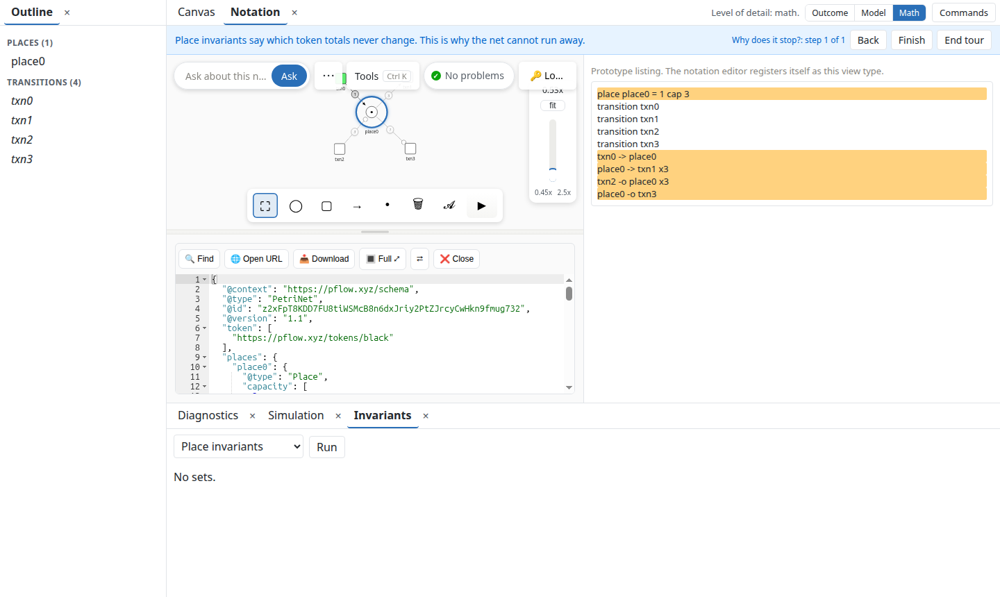
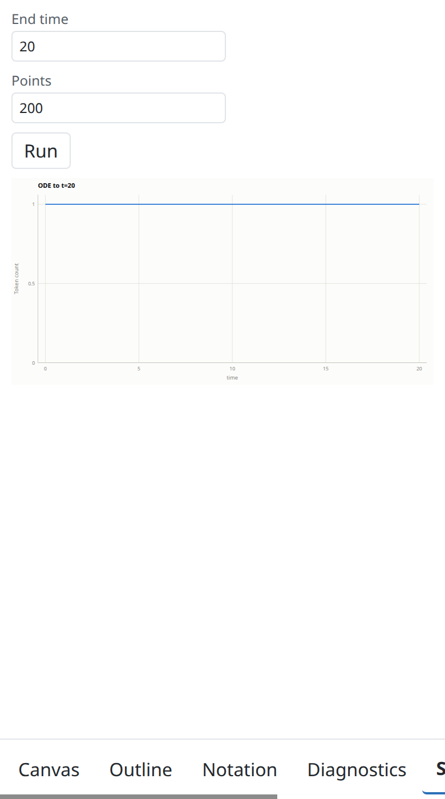

# The IDE shell

Status: prototype, behind `?shell=1` (off by default, remembered in `localStorage.pflow_shell`; `?shell=0` clears it).
Nothing of it loads without the flag, so it merges inert. Branch `feat/ide-shell`.

pflow.xyz is a Petri-net editor that grew some twenty-five dialogs, panes and menus (counted below). Matt's direction: make it resemble an IDE that **opens panels
and modal windows to show data and results**, controlled by one idea, the **level of abstraction** the person is looking
at, and drivable by an agent (over MCP) that can open views, point at things, change the level and narrate.

This document has four parts: what exists and what to cut, merge or hide (section 1); the layout (section 2); the one
registry that every result, local or pushed, goes through, with its levels, targets and verbs (section 3); and what the
other two runs on this pivot need from each other (section 5). Sections 4, 6 and 7 cover phone, CSP and testing.



## 1. Survey: what there is, and what to cut, merge or hide

Counted from `public/index.html`, `petri-view.js` (about 9000 lines, one `<petri-view>` element) and the modules that
file imports. "Verified" means I opened the code; the rest is from file headers and method names.

| Today | What it is | Verdict | Becomes |
|---|---|---|---|
| `/` landing (chat prompt, six example cards, JSON-LD) | marketing and entry; the crawlers' page | **keep**, unchanged | `?shell=1` skips it and opens the editor |
| `<petri-view>` canvas, toolbar, run bar, fire sheet | the editor | **keep** | the `canvas` view, center; not moved in the DOM |
| JSON-LD pane (Ace) with a divider and a stacked / side-by-side toggle | second editor under the canvas | **hide** at the model level, show at math | a `jsonld` panel (not done; see section 8) |
| Top bar: Ask input, File / View / Help, Tools, problems chip, account | the appbar | **keep for now**, **merge** the entry points | Ask input = Ask panel; Tools = the palette; chip = Diagnostics tab |
| Hamburger (`?ui=classic`) | the old menu, kept one release | **cut** after that release | gone |
| Tools palette (Ctrl/Cmd-K): every registry command and goal as a form | the deterministic escape hatch | **keep** | reachable from the shell palette ("Tools…") |
| Goals dialog ("What do you want to know?"), Tools > Questions, the Ask input's router | three doors to the same goal catalogue | **merge** | one: the palette and the Ask panel |
| Results dialog, Analysis dialog, Check dialog, Structure dialog, Simulate dialog | five dialogs that show an artifact | **merge** | panels `plot`, `invariants`, `reachability`, `diagnostics` (moved: four of them) and the `result` modal for anything else |
| Ask pane (chat, result cards, pending-edit card) | docked pane, `position: fixed` | **keep**, **dock** | an `ask` panel in the right dock (not done) |
| App view (the net as an operator's console) | docked pane | **keep**, it is an outcome-level view | an `appview` panel at the outcome level (not done) |
| Components palette | dialog | **merge** into the left dock | `components` panel (not done) |
| Describe / Draft dialog, Draft notes | LLM drafting | **keep**, **dock** | the Ask panel's build mode |
| Share dialog, My diagrams, Account save, Account files, Edit diagram details | five dialogs about saved things | **merge** | one `files` modal and one `share` modal (not done) |
| Layout algorithms, Display settings, Help, Edit details, token breakdown, label editor, Open URL | small dialogs | **hide** | `settings` modal (moved: its shell part) and the palette |
| String-diagram modal and `/compose.html` (ten composition views, its own registry in `public/compose/views-meta.js`) | the categorical views | **keep as a page**, **frame** it | the `categorical` modal (moved), later one registry entry per composition view |
| `/mcp.html`, `/schema`, `/tokens/*`, `/share-card/*`, `/img/*` | static and server-rendered pages | **keep** | linked from the palette |

Verdict summary: of the dialogs and panes above, **four views move into the shell now** (plus two modals), most of the
rest merge into a handful of destinations, the classic hamburger is cut after its release, and everything else stays where it
is until its turn. The editor itself is not
touched: that is what keeps this a prototype that can ship behind a flag.

## 2. Layout

```
+---------+------------------------------------------+----------+
| left    |  center bar:  [Canvas] [Notation]   Level: Outcome Model Math   Commands
|         |  narration strip (an agent's words, tour controls)   |
| Outline +------------------------------+-----------+  right   |
|         |  canvas (<petri-view>)       | notation  |          |
|         |  (beside it at >= 1100 px,   | (split)   |          |
|         |   a tab below that)          |           |          |
|         +------------------------------+-----------+          |
|         |  bottom: [Diagnostics] [Simulation] [Invariants] [Reachability]  |
+---------+------------------------------------------+----------+
```

* `#editor-wrapper` becomes a CSS grid (`.pf-shell`); the docks are added to it as siblings. The `<petri-view>` is
  **not moved**, so its state, listeners and 9000 lines are untouched. (Re-parenting a custom element runs its
  `disconnectedCallback`; the grid avoids the question.)
* Four docks: `left`, `center`, `right`, `bottom`. A dock is a tab strip and a body. One panel is shown per dock. The
  center dock sits beside the canvas on a wide screen (a split) and is a tab on a narrower one.
* Splitters are `role="separator"`, draggable and arrow-key operable (Shift for a bigger step). Sizes are clamped.
* A **modal** is a native `<dialog>`: focus trap, Escape and the backdrop come from the platform. One at a time; a
  second replaces the first.
* The **command palette** (Ctrl/Cmd+Shift+P; Ctrl/Cmd-K stays the editor's own Tools) lists every registered view
  ("Open Simulation"), layout actions ("Move Simulation to right"), level changes, and "Tools…" which hands over to
  the editor's palette. It is built from the registry, so a new view appears in it without code.
* The layout (which panels, which dock, sizes, level) is stored in `localStorage.pflow_shell_layout`. **It holds ids and
  types, never a net or a payload**: a reload brings the panels back empty and each reads the live canvas.
* No drag-and-drop docking. Moving a panel is a palette command. (A taste call: drag docking is a large amount of
  pointer code for a layout nobody changes twice.)



## 3. The registry

One module, `public/petri-shell.js` (no DOM, no network; deno tests it). Everything that shows a result goes through it.

### 3.1 A view type

```js
pflowShell.registry.register({
  type: 'plot',                 // lower-case name; the `view` an MCP `show` event carries
  kind: 'panel',                // 'panel' lives in a dock; 'modal' opens over everything
  dock: 'bottom',               // panels: left | center | right | bottom
  level: 'outcome',             // outcome | model | math: the least detail at which it is shown
  title: 'Simulation',
  singleton: true,              // opening it again reuses it
  render(host, payload, ctx) {  // draw into `host`; return {update(payload), dispose()} if you need to
  },
});
```

A later `register` of the same `type` **replaces** the earlier (the notation panel does that to the stand-in).
`registry.types()` returns `{type, kind, level, dock?, title}` for each, for a `hello` event, tool enums and the palette.

Built in now:

| type | kind | dock | level | notes |
|---|---|---|---|---|
| `canvas` | panel (pinned) | center | model | the editor, already on the page; opening it reveals it |
| `notation` | panel | center | model | **stand-in** (a read-only listing); replaced by run 19a75ca7's panel |
| `answer` | panel | center | outcome | the plain-language narration; the center when there is no canvas |
| `outline` | panel | left | model | places and transitions; a click highlights on the canvas |
| `diagnostics` | panel | bottom | model | `analysis.check` and `analysis.behaviour`, plus anything published to `ctx.diagnostics` |
| `plot` | panel | bottom | outcome | `sim.ode` |
| `invariants` | panel | bottom | math | `analysis.invariants` |
| `reachability` | panel | bottom | math | `analysis.reachability` |
| `categorical` | modal | | math | `/compose.html?cid=…#view=…` in a frame; needs a stored `cid` |
| `result` | modal | | outcome | generic text; also the fallback for an unknown `view` |
| `settings` | modal | | outcome | layout reset, the list of view types, back to the classic layout |

The six names `canvas, plot, reachability, invariants, categorical, notation` are the `show` views of the MCP tab-push
protocol (PR #132, `docs/design/tab-push.md`), kept verbatim so that protocol needed no change.

### 3.2 What a view may touch: `ctx`

| | |
|---|---|
| `ctx.net.get()` / `ctx.net.set(net, {origin})` | the canvas's net (a clone) / load a net through the strict gate (`file.load_json`: refused if invalid; one undo step) |
| `ctx.execute(id, args)` | any registry command (`sim.ode`, `analysis.check`, …); the result's `artifact` is an id, `ctx.artifact(id)` the object |
| `ctx.on('net' \| 'highlight' \| 'narration' \| 'level', fn)` | subscribe; returns an unsubscribe |
| `ctx.diagnostics.set(source, items)` / `.get()` / `.on(fn)` | one list the Diagnostics panel shows; items `{severity: 'error'\|'warn'\|'info', message, nodes?, line?, col?}`; `set(source, [])` clears |
| `ctx.reveal(evt)` | open another view (the same event an MCP push sends) |
| `ctx.parseTarget(t)`, `ctx.highlight(ids)`, `ctx.solver()`, `ctx.close()` | helpers |

A view with no payload reads the live canvas. A view must not use inline handlers or style attributes (section 6); the
`h()` helper in `petri-shell-views.js` builds elements with `addEventListener`.

### 3.3 Levels

The point of the pivot is to control **how much of the machinery is on screen**.

| level | what the person sees | views at this level |
|---|---|---|
| `outcome` | a question and its answer in plain words; no Petri-net terms | `answer`, `plot`, `result`, `settings` |
| `model` (default) | the net: canvas, notation, outline, checks | everything above, plus `canvas`, `notation`, `outline`, `diagnostics` |
| `math` | the structure underneath | everything, plus `invariants`, `reachability`, `categorical` |

A view declares the least detail it needs (`level`). The shell shows a view only at or above that level. At `outcome`
there is no canvas and no left dock: the `answer` panel is the center. Raising the level to `outcome` closes views above
it. **"Step down" means more detail**: the person's control is a three-button radio group in the center bar, and the
palette has the same three commands.

An agent that asks for a view above the current level is **refused with what it needs**
(`{ok:false, needs:'math', level:'model'}`), and the person sees a notice with a "Step down to math" button. Nothing
silently raises the level on the agent's say-so; to teach upward the agent sends `{type:'level'}` first, and the person
can still use the control at any time.

### 3.4 Targets

How an event points at something. Shared with the notation panel so one id means the same thing everywhere.

| target | meaning |
|---|---|
| `node:<id>` | a place or transition: highlighted on the canvas, and every notation line that mentions it |
| `line:<n>`, `range:<a>-<b>` | lines of the notation text |
| `panel:<id>` | an open panel (activates it) |
| `view:<type>` | a view type (opens it) |

### 3.5 Events: the one entry, `pflowShell.dispatch(evt)`

`pflowShell.open` is an alias, so a caller written against "open" works for every verb. `type` defaults to `show`. Every
verb answers `{ok, …}` and never throws on a bad event; an MCP push must get an answer.

| `type` | fields | effect |
|---|---|---|
| `show` | `view`, `net` or `cid`, `params`, `note`, `request_id` | open a view. A `net` goes on the canvas first (strict gate; the notice says "Claude put a net on the canvas" with **Undo**). An unregistered `view` degrades to the `result` modal showing `note`. A panel opened with a payload runs at once; opened by hand it waits for Run |
| `level` | `level` | set the abstraction level |
| `highlight` | `targets: []`, `label?` | mark targets; `[]` clears |
| `annotate` | `id?`, `target?`, `text` | narrate (and highlight `target`); `text: ''` removes `id` |
| `focus` | `target` | `panel:`/`view:` open or activate; `node:`/`line:` highlight |
| `tour` | `title?`, `steps: [event + say?, …]` (at most 30, none a tour) | a guided sequence; step 1 runs now; the strip shows `say`, "step n of m", **Back / Next / End tour** |
| `tour_control` | `action: next\|back\|end` | what the buttons do, for an agent |
| `stop` | | close the modal and every panel a push opened (what the person opened stays) |

Bounds match tab-push: a net of at most 256 KiB, a note of at most 1000 characters.

`pflowShell.state()` answers `{shell:1, level, tour: {title, step, of}|null, panels: [{id,type,dock,active}], modal,
views}`: ids and types only, **never a net**, so it is safe to put in a tab report.

### 3.6 Privacy

A pushed net is held in memory for delivery and is never written to `localStorage`, to the layout, to `state()` or to a
log. The tests assert it (`petri-shell_test.ts`, `shell-smoke.ts`).

## 4. Phone

At 760 px and below every dock folds into one bottom tab bar (Canvas, each open panel, and "⋯" for the palette). One view
fills the screen; tab buttons are at least 44 px. The narration strip stays on top. The same media query drives the CSS
and the script (`matchMedia`), so they cannot disagree.

## 5. What each run on this pivot needs from the others

Three runs, one flag, one registry. All three are PRs, none merged.

| | what it is | what it needs |
|---|---|---|
| **#132 tab push** (31ead7e7, `feat/tab-push`, `PFLOW_TAB_PUSH=1`) | an MCP client pushes `show` events into an open page | already calls `window.pflowShell.open(evt)` / `.close(id)` / `.state()` when present (`shellOpen`, `shellClose` in `petri-view.js`). **Needs to add:** forward every unknown event type to `pflowShell.dispatch`; MCP tools for the new verbs (`pflow_level`, `pflow_highlight`, `pflow_annotate`, `pflow_tour`, or one `pflow_teach` taking `events: []`); surface a refused `show` (`{ok:false, needs}`) to the MCP caller; take its `hello` `views` from `registry.types()` instead of a hard-coded list |
| **#133 notation** (19a75ca7, `design/pflow-notation`) | the language: grammar, Go compiler and advisor | a JS or wasm entry point (none yet). **Then:** register `notation` over the stand-in (`pflowShell.registry.register({type:'notation', …})`), publish parse errors and advisor output with `ctx.diagnostics.set('notation', …)`, take `line:`/`range:`/`node:` targets with `ctx.on('highlight')` |
| **this PR** | the shell, the registry, levels, targets, verbs | nothing from the others to merge; it is inert without `?shell=1` |

Merge order does not matter: without the flag the shell does not load; without the shell #132 falls back to its own path;
without #132 or #133 the shell has its stand-ins. When all three are in, one flag turns on the whole experience.

Both peers had finished when I tried to send them the verbs and levels (the messages are kept in
`~/val/inbox/31ead7e7/` and `~/val/inbox/19a75ca7/`), so the "Needs" column above is the hand-off.

## 6. Strict CSP

The shell's own modules are built for a policy with no inline script and no inline style:

* No inline event handler, no `style` attribute, no `eval`, `new Function`, `document.write` or `javascript:` URL in
  `petri-shell*.js` (`petri-shell_test.ts` scans the sources for each).
* Every look is a class in `petri-shell.css`, which uses tokens from `petri-view.css` only (so dark mode is free) and
  has no literal colour. The one thing script sets is a custom property per dock size, through the CSSOM, which
  `style-src` allows.
* The renderers the panels reuse (`petri-results.js`, the solver's SVG plotter) write `style="…"` into their SVG. Under
  `style-src-attr 'none'` that is refused at parse time and the chart loses its styling. `setMarkup()` moves each such
  attribute to a data attribute before parsing and applies it with `el.style.cssText`, which the policy allows. The
  shared plotter is not edited: `petri-solver.js` is vendored by three other repos.
* `shell-smoke.ts` arms `script-src-attr 'none'; style-src-attr 'none'` and drives every view, then asserts no
  `securitypolicyviolation` event fired.

What stops the **page** from carrying a full policy header today, and is outside this PR: `index.html` has an inline
`<script>` (landing/editor switch) and a large inline `<style>`; the analytics tag is injected inline by
`static_pages.go`; the wasm engine needs `'wasm-unsafe-eval'` and loads from `cdn.stackdump.com`. The target policy is
`default-src 'self'; script-src 'self' 'wasm-unsafe-eval' https://cdn.stackdump.com; style-src 'self'; frame-src 'self';
object-src 'none'; base-uri 'none'; frame-ancestors 'self'`, reachable by moving those two inline blocks to files and
hashing or dropping the analytics tag. The JSON-LD in `index.html` is a `<script type="application/ld+json">` data block,
which a CSP does not execute, so crawlers keep it.

## 7. Tests

| | |
|---|---|
| `public/petri-shell_test.ts` (in `make test-js`) | 20 tests: registry validation, event planning and caps, the unknown-view fallback, singleton and modal rules, pinned canvas, stop, layout sanitising and the privacy rule, levels and refusal, targets, every verb, tours, the palette filter, the flag, and the CSP source scan |
| `scripts/shell-smoke.ts` (in `scripts/smoke-gate.sh`, needs Chrome and a server) | 73 checks in headless Chrome: flag off and on; every built-in view opens and draws; tabs, splitter by keyboard; both modals and Escape; the palette; a pushed net, Undo, `stop`; persistence; the level control, refusal and step-down; highlight; a tour; the outcome level; split at 1400 px and tabs at 1000; a 390 px phone; no CSP violation; no console error |

```
make test-js
scripts/smoke-gate.sh                  # builds, serves on a scratch port, runs every smoke
SMOKES=shell scripts/smoke-gate.sh     # this one
```

## 8. Not done, and taste calls

Not done: the Ask pane, App view and Components as panels; the `jsonld` panel (the editor's built-in JSON pane still sits
under the canvas inside `<petri-view>`); the `files` and `share` modals; `reachability` and `invariants` rely on the wasm
engine and say so when it is not loaded; pointer hover on a plot is not wired (the plotter's SVG draws, its hover script
is the dialog's); the `categorical` modal frames `/compose.html` and needs a stored `cid`; a `cid` on `show` is noted but
does not open the net (the page opens a stored net by `?cid=`); the shell has no mobile drag; the refusal notice is
shown only in the page, the MCP caller learns of it from the answer.

Taste calls:

1. **Levels over modes.** One control (three words) decides what is on screen, and each view declares its own level, so
   a new view is placed by one field. The alternative, per-role layouts, would have been a second axis.
2. **The person steps down, the agent asks.** A refused view is a button, not a silent change. The agent sets the level
   with a verb when teaching, which is visible in the control.
3. **The editor is not moved.** A grid around the existing element, not a rewrite into components. Cost: the editor's own
   appbar and JSON pane remain until their turn.
4. **No drag docking**; moving is a palette command.
5. **A refused or unknown view degrades to text** instead of failing, so a newer MCP server's view still shows.
6. **Native `<dialog>`** for modals and the palette: the platform owns focus trap, Escape and backdrop.
7. **Layout holds ids, never data**, so privacy is structural rather than a rule someone must remember.
